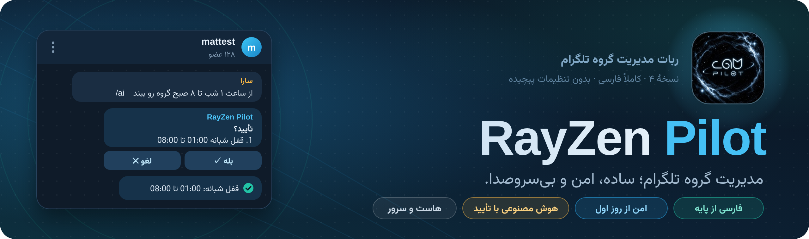
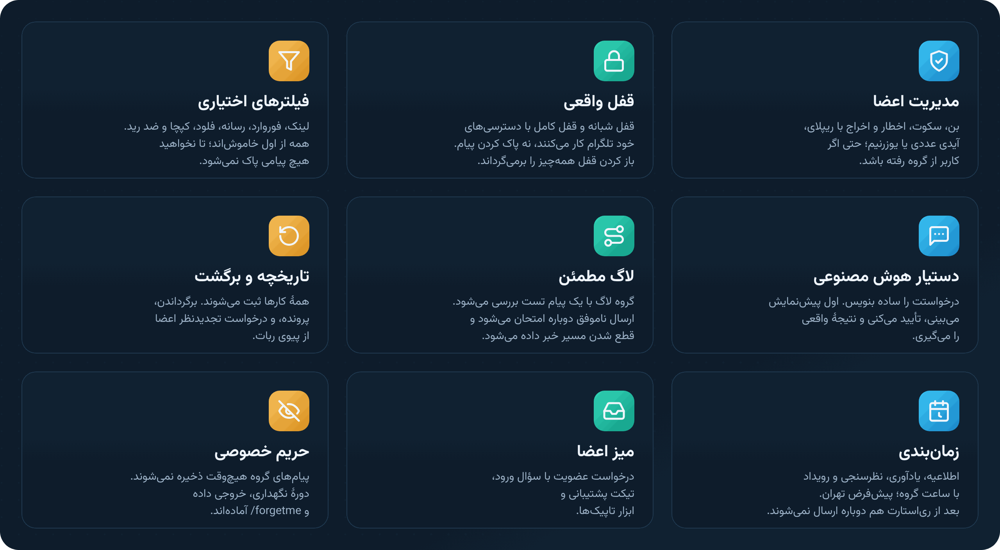
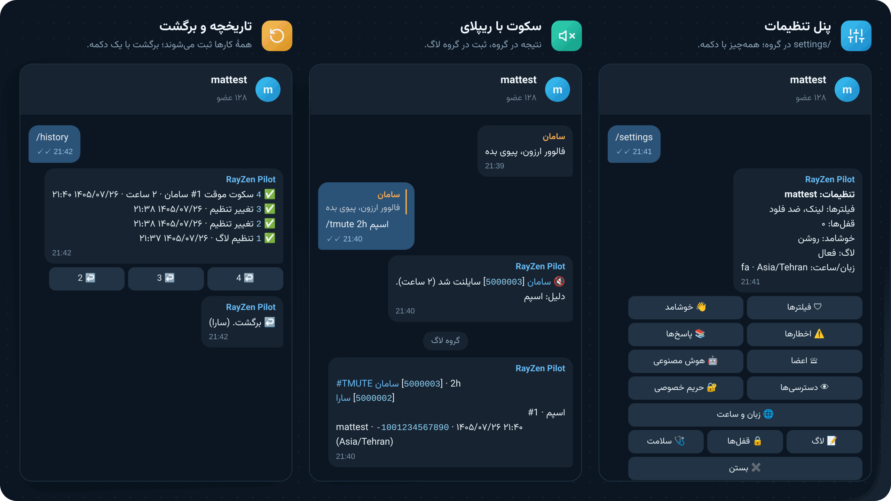
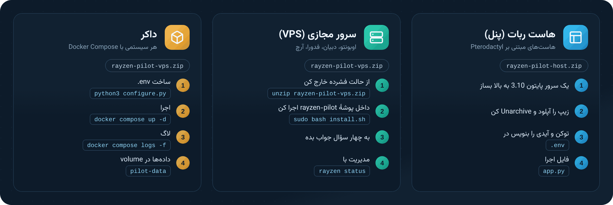
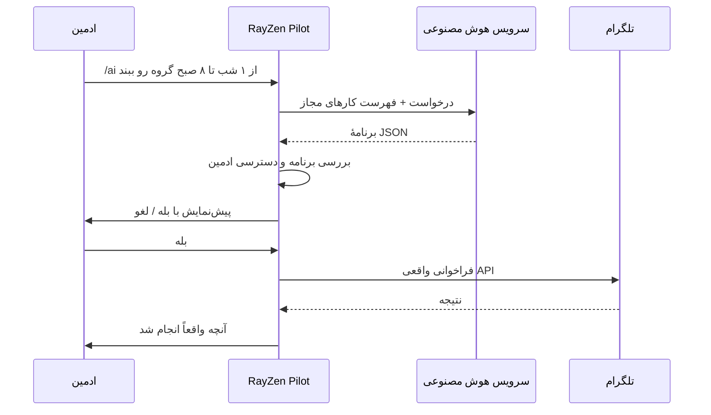
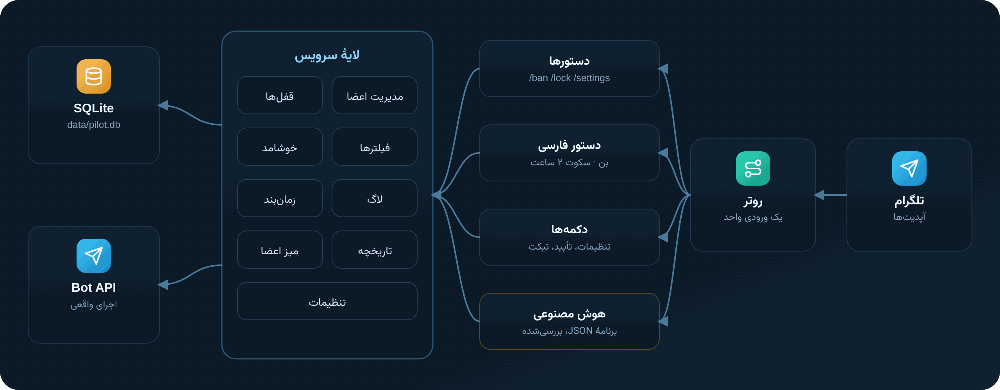

<p align="center">
  
</p>

<p align="center">
  
  
  
  
  
  <a href="https://github.com/matttsys/RayZen-Pilot/releases/latest"></a>
  <a href="https://github.com/matttsys/RayZen-Pilot/blob/main/LICENSE"></a>
</p>

<p align="center">
  <a href="README.md">English</a> &nbsp;·&nbsp; <b>فارسی</b>
</p>

<div dir="rtl">

<p align="center">
  <a href="#fa-download">دانلود</a> ·
  <a href="#fa-features">امکانات</a> ·
  <a href="#fa-install">نصب</a> ·
  <a href="#fa-first-run">اولین اجرا</a> ·
  <a href="#fa-configuration">تنظیمات</a> ·
  <a href="#fa-commands">دستورها</a> ·
  <a href="#fa-ai">هوش مصنوعی</a> ·
  <a href="#fa-updating">به‌روزرسانی</a> ·
  <a href="#fa-troubleshooting">رفع مشکل</a>
</p>

---

RayZen Pilot ربات مدیریت گروه تلگرام است. پیش‌فرضش فارسی است، به‌جز SQLite به هیچ سرویس دیگری نیاز ندارد و همهٔ فیلترهایش از اول خاموش‌اند. تا ادمین چیزی نخواهد، در گروه هیچ تغییری نمی‌دهد.

<a name="fa-download"></a>

## دانلود

| پوشه | فایل ریلیز | برای |
|---|---|---|
| [‎`host/`‎](https://github.com/matttsys/RayZen-Pilot/tree/main/host) | [**rayzen-pilot-host.zip**](https://github.com/matttsys/RayZen-Pilot/releases/latest/download/rayzen-pilot-host.zip) | هاست ربات (egg پایتون در Pterodactyl) |
| [‎`vps/`‎](https://github.com/matttsys/RayZen-Pilot/tree/main/vps) | [**rayzen-pilot-vps.zip**](https://github.com/matttsys/RayZen-Pilot/releases/latest/download/rayzen-pilot-vps.zip) | سرور لینوکس با systemd و داکر |
| | [rayzen-pilot-dev.zip](https://github.com/matttsys/RayZen-Pilot/releases/latest/download/rayzen-pilot-dev.zip) | سورس به‌همراه تست‌ها، برای توسعه |

ربات هر دو پوشه یکی است. ‎`vps/`‎ نصب‌کننده، سرویس systemd، دستور ‎`rayzen`‎ و فایل‌های داکر را هم دارد. فایل‌های ربات در هر زیپ با پوشهٔ خودش یکی است؛ هر کدام راحت‌تر است را بردار. چک‌سام‌ها در [SHA256SUMS.txt](https://github.com/matttsys/RayZen-Pilot/releases/latest/download/SHA256SUMS.txt) هستند و نسخه‌های قبلی در صفحهٔ [Releases](https://github.com/matttsys/RayZen-Pilot/releases).

<a name="fa-features"></a>

## امکانات



### وقتی به گروه اضافه می‌شود

| بخش | پیش‌فرض |
|---|---|
| **پیام‌ها** | هیچ پیامی پاک نمی‌شود. همهٔ فیلترها خاموش‌اند. |
| **دسترسی‌ها** | چیزی عوض نمی‌شود. قفل فقط با درخواست ادمین اعمال می‌شود و با باز کردنش همه‌چیز به حالت قبل برمی‌گردد. |
| **اعضا** | عضو عادی نه با دستور و نه با هوش مصنوعی نمی‌تواند کسی را مدیریت کند. |
| **پیام اول** | یک پیام کوتاه با فهرست دسترسی‌های ناقص و دکمه‌های تنظیمات و راهنما. |
| **دادهٔ نسخهٔ قبل** | قوانین، یادداشت‌ها، اخطارها و کلیدواژه‌ها منتقل می‌شوند. فیلترهای قدیمی خاموش می‌مانند و در ‎`/legacy`‎ فهرست می‌شوند. |

## داخل چت



این‌ها جواب‌های واقعی ربات‌اند که در قاب تلگرام نمایش داده شده‌اند.

<a name="fa-install"></a>

## نصب



| | هاست ربات (پنل) | سرور مجازی | داکر |
|---|---|---|---|
| **فایل** | [‎`rayzen-pilot-host.zip`‎](https://github.com/matttsys/RayZen-Pilot/releases/latest/download/rayzen-pilot-host.zip) | [‎`rayzen-pilot-vps.zip`‎](https://github.com/matttsys/RayZen-Pilot/releases/latest/download/rayzen-pilot-vps.zip) یا ‎`git clone`‎ | [‎`rayzen-pilot-vps.zip`‎](https://github.com/matttsys/RayZen-Pilot/releases/latest/download/rayzen-pilot-vps.zip) یا ‎`git clone`‎ |
| **پوشه در ریپو** | ‎`host/`‎ | ‎`vps/`‎ | ‎`vps/`‎ |
| **نیازمندی** | سرور پایتون 3.10 به بالا روی پنل | لینوکس با systemd و دسترسی root | Docker و Compose |
| **تنظیم** | ویرایش ‎`.env`‎ در فایل منیجر | نصب‌کنندهٔ تعاملی | ‎`configure.py`‎ یا ویرایش ‎`.env`‎ |
| **اجرای دوباره بعد از کرش** | سوپروایزر داخلی و پنل | systemd | Compose |

قبل از شروع این‌ها را آماده کن:

1. توکن ربات از ‎[@BotFather](https://t.me/BotFather)‎
2. آیدی عددی تلگرام خودت (به ‎[@userinfobot](https://t.me/userinfobot)‎ پیام ‎`/start`‎ بده)
3. اختیاری: کلید API یک سرویس سازگار با OpenAI، اگر ‎`/ai`‎ را می‌خواهی

### هاست ربات (پنل)

روی هاست‌های مبتنی بر Pterodactyl که سرور پایتون دارند کار می‌کند.

1. یک سرور با egg **Python** نسخهٔ 3.10 یا بالاتر بساز.
2. فایل [‎`rayzen-pilot-host.zip`‎](https://github.com/matttsys/RayZen-Pilot/releases/latest/download/rayzen-pilot-host.zip) را دانلود کن. در بخش **Files** آپلودش کن و **Unarchive** را بزن. ‎`app.py`‎ باید در پوشهٔ اصلی باشد، نه داخل یک زیرپوشه.
3. اسم ‎`.env.example`‎ را به ‎`.env`‎ تغییر بده و ‎`BOT_TOKEN`‎ و ‎`OWNER_ID`‎ را پر کن.
4. در **Startup** مطمئن شو *App py file* روی ‎`app.py`‎ و *Requirements file* روی ‎`requirements.txt`‎ باشد. این دو پیش‌فرض خود egg هستند.
5. **Start** را بزن. وقتی ربات آنلاین شود، در کنسول ‎`up as @yourbot`‎ چاپ می‌شود.

> اگر قبل از مرحلهٔ ۳ دکمهٔ Start را بزنی، ربات خودش ‎`.env`‎ را می‌سازد و با یک پیام می‌گوید چه چیزی را باید پر کنی.

در بیشتر پنل‌ها پکیج‌ها داخل ‎`.local`‎ نصب می‌شوند و ‎`app.py`‎ خودش پیدایشان می‌کند. اگر پنل پورت بدهد، روی همان پورت یک health check با خروجی JSON در دسترس است.

<details>
<summary><b>نصب با Git به‌جای زیپ</b></summary>

اگر egg پایتون پنلت فیلد *Git Repo Address* دارد، پنل می‌تواند خودش این ریپو را کلون کند. این مقدارها را در **Startup** بگذار و بعد از بخش **Settings** سرور را Reinstall کن:

| متغیر | مقدار |
|---|---|
| Git Repo Address | ‎`https://github.com/matttsys/RayZen-Pilot`‎ |
| Install Branch | ‎`main`‎ |
| User Uploaded Files | ‎`0`‎ |
| App py file | ‎`host/app.py`‎ |
| Requirements file | ‎`host/requirements.txt`‎ |
| Auto Update | ‎`1`‎ برای گرفتن آخرین کد در هر بار اجرا (اختیاری) |

بعد از Reinstall، در **Files** وارد پوشهٔ ‎`host/`‎ شو، اسم ‎`.env.example`‎ را به ‎`.env`‎ تغییر بده، پرش کن و **Start** را بزن. ‎`.env`‎ و ‎`data/`‎ در git نیستند، پس با آپدیت دست نمی‌خورند.

</details>

### سرور مجازی (VPS)

با git:

</div>

```bash
git clone https://github.com/matttsys/RayZen-Pilot.git
cd RayZen-Pilot/vps
sudo bash install.sh
```

<div dir="rtl">

یا با زیپ ریلیز:

</div>

```bash
sudo apt install -y unzip curl     # Debian/Ubuntu, if they're missing
curl -LO https://github.com/matttsys/RayZen-Pilot/releases/latest/download/rayzen-pilot-vps.zip
unzip rayzen-pilot-vps.zip
cd rayzen-pilot
sudo bash install.sh
```

<div dir="rtl">

نصب‌کننده این کارها را انجام می‌دهد:

- پایتون 3.10 به بالا را پیدا می‌کند یا نصبش می‌کند (apt، dnf، yum، pacman، zypper)
- کاربر سیستمی ‎`rayzen`‎ را می‌سازد و ربات را در ‎`/opt/rayzen-pilot`‎ نصب می‌کند
- یک virtualenv با همهٔ وابستگی‌ها آماده می‌کند
- توکن، آیدی مالک، کلید هوش مصنوعی و منطقهٔ زمانی را می‌پرسد. توکن را با تلگرام چک می‌کند و اگر به ربات پیام بدهی، آیدی‌ات را خودش پیدا می‌کند.
- سرویس systemd با نام ‎`rayzen-pilot`‎ و دستور ‎`rayzen`‎ را نصب می‌کند

برای نصب بدون سؤال، مقدارها را به‌صورت متغیر بده:

</div>

```bash
sudo BOT_TOKEN=123456:ABC... OWNER_ID=111222333 AI_API_KEY=sk-... bash install.sh
```

<div dir="rtl">

با ‎`INSTALL_DIR`‎ و ‎`SERVICE_USER`‎ می‌توانی مسیر نصب و کاربر را عوض کنی.

| دستور | کار |
|---|---|
| ‎`rayzen status`‎ | روشن یا خاموش، مدت اجرا، یوزرنیم ربات |
| ‎`rayzen logs`‎ / ‎`rayzen logs -f`‎ | ۱۰۰ خط آخر / دنبال کردن زنده |
| ‎`rayzen start`‎ · ‎`stop`‎ · ‎`restart`‎ | کنترل سرویس |
| ‎`rayzen config`‎ | پرسیدن دوبارهٔ سؤال‌ها و ری‌استارت |
| ‎`rayzen backup`‎ | پشتیبان دیتابیس و ‎`.env`‎ در ‎`/opt/rayzen-pilot/backups`‎ |
| ‎`rayzen update <zip or folder>`‎ | نصب نسخهٔ جدید با حفظ ‎`.env`‎ و داده‌ها |
| ‎`rayzen uninstall`‎ | حذف سرویس؛ قبل از پاک کردن داده‌ها می‌پرسد |

### داکر

</div>

```bash
git clone https://github.com/matttsys/RayZen-Pilot.git && cd RayZen-Pilot/vps
# or: unzip rayzen-pilot-vps.zip && cd rayzen-pilot
python3 configure.py               # or: cp .env.example .env && nano .env
docker compose up -d
docker compose logs -f
```

<div dir="rtl">

دیتابیس در volume با نام ‎`pilot-data`‎ نگه داشته می‌شود. برای به‌روزرسانی، فایل‌ها را جایگزین کن و ‎`docker compose up -d --build`‎ را اجرا کن.

### اجرا از سورس

این دستورها را داخل ‎`host/`‎ یا ‎`vps/`‎ اجرا کن:

</div>

```bash
python3 -m venv .venv && . .venv/bin/activate     # Windows: .venv\Scripts\activate
pip install -r requirements.txt
cp .env.example .env                              # fill in BOT_TOKEN and OWNER_ID
python app.py
```

<div dir="rtl">

<a name="fa-first-run"></a>

## اولین اجرا در گروه

1. ربات را به گروه اضافه کن و ادمینش کن.
2. دسترسی‌های لازم برای امکاناتی را که می‌خواهی بده:

   | دسترسی | برای |
   |---|---|
   | حذف پیام | فیلترها، ‎`/del`‎، ‎`/purge`‎ |
   | بن کاربران | بن و سکوت، قفل گروه، کپچا |
   | سنجاق پیام | سنجاق و اطلاعیهٔ سنجاق‌شده |
   | دعوت کاربر با لینک | میز درخواست عضویت، لینک دعوت |
   | مدیریت تاپیک | ابزار تاپیک (فقط گروه‌های انجمنی) |
   | افزودن ادمین | ‎`/promote`‎ و ‎`/demote`‎ (اختیاری) |

3. ‎`/settings`‎ را بفرست. ‎`/health`‎ دسترسی‌هایی را که هنوز ناقص‌اند نشان می‌دهد.
4. گروه لاگ را وصل کن: یک گروه خصوصی بساز، ربات را در آن ادمین کن، بعد در گروه اصلی ‎`/setlog`‎ بفرست و کدی را که می‌دهد دنبال کن. اگر آیدی گروه لاگ را داری، ‎`/setlog -100…`‎ هم مستقیم کار می‌کند.
5. هر چه لازم داری روشن کن: ‎`/antilink on`‎، ‎`/flood on 6 mute`‎، ‎`/captcha on`‎، ‎`/night 01:00 08:00`‎.

ربات وقتی ادمین باشد همهٔ پیام‌های گروه را می‌بیند، پس لازم نیست privacy mode را در BotFather عوض کنی.

<a name="fa-configuration"></a>

## تنظیمات

همهٔ تنظیمات در فایل ‎`.env`‎ کنار ‎`app.py`‎ است. فقط دو مورد اول اجباری‌اند.

| کلید | پیش‌فرض | توضیح |
|---|---|---|
| ‎`BOT_TOKEN`‎ | | از ‎@BotFather‎. **اجباری** |
| ‎`OWNER_ID`‎ | | آیدی عددی تلگرام تو. **اجباری** |
| ‎`AI_BASE_URL`‎ | Nous Portal | هر endpoint سازگار با OpenAI که به ‎`/v1`‎ ختم شود |
| ‎`AI_API_KEY`‎ | خالی | خالی یعنی ‎`/ai`‎ خاموش است؛ بقیهٔ امکانات کار می‌کنند |
| ‎`AI_MODEL`‎ | در ‎`.env.example`‎ | شناسهٔ مدل در سرویس‌دهنده |
| ‎`AI_FALLBACK_MODELS`‎ | در ‎`.env.example`‎ | با کاما جدا می‌شوند و به ترتیب امتحان می‌شوند |
| ‎`TZ`‎ | ‎`Asia/Tehran`‎ | منطقهٔ زمانی پیش‌فرض گروه‌های جدید؛ هر گروه با ‎`/timezone`‎ عوضش می‌کند |
| ‎`LOG_CHANNEL`‎ | خالی | آیدی چت برای پیام‌های مالک؛ خالی یعنی پیوی خودت |
| ‎`DB_PATH_PILOT`‎ | ‎`data/pilot.db`‎ | فایل SQLite |
| ‎`LOG_LEVEL`‎ | ‎`INFO`‎ | برای جزئیات بیشتر ‎`DEBUG`‎ |
| ‎`SERVER_PORT`‎ | خالی | پورت health check؛ معمولاً پنل خودش تنظیمش می‌کند |

<details>
<summary><b>محدودیت‌های هوش مصنوعی</b></summary>

| کلید | پیش‌فرض |
|---|---|
| ‎`AI_TIMEOUT_S`‎ | ‎`60`‎ |
| ‎`AI_CONCURRENCY`‎ | ‎`2`‎ |
| ‎`AI_USER_PER_10MIN`‎ | ‎`8`‎ |
| ‎`AI_GROUP_PER_HOUR`‎ | ‎`30`‎ |
| ‎`AI_GLOBAL_PER_DAY`‎ | ‎`3000`‎ |
| ‎`AI_EXTRA_BODY`‎ | JSON اضافه برای هر درخواست، مثل ‎`{"temperature":0.2}`‎ |

</details>

<a name="fa-commands"></a>

## دستورها

‎`/help`‎ در خود ربات همهٔ دستورها را بخش‌به‌بخش نشان می‌دهد. خلاصه:

| بخش | دستورها |
|---|---|
| مدیریت اعضا | ‎`/ban`‎ ‎`/tban 2h`‎ ‎`/unban`‎ ‎`/mute`‎ ‎`/tmute 30m`‎ ‎`/unmute`‎ ‎`/kick`‎ ‎`/warn`‎ ‎`/warns`‎ ‎`/rmwarn`‎ ‎`/resetwarns`‎ ‎`/promote`‎ ‎`/demote`‎ ‎`/info`‎ ‎`/id`‎ |
| پیام‌ها | ‎`/del`‎ ‎`/purge`‎ ‎`/pin`‎ ‎`/unpin`‎ ‎`/unpinall`‎ ‎`/report`‎ |
| قفل | ‎`/lock [type] [time]`‎ ‎`/unlock`‎ ‎`/lockdown 1h`‎ ‎`/lockstatus`‎ ‎`/night 01:00 08:00`‎ ‎`/slowmode`‎ ‎`/cooldown on 30`‎ |
| فیلترها | ‎`/antilink`‎ ‎`/antiforward`‎ ‎`/antichannel`‎ ‎`/block photos`‎ ‎`/addblock word`‎ ‎`/blocklist`‎ ‎`/flood on 6 mute`‎ ‎`/captcha on`‎ ‎`/antiraid on`‎ ‎`/cleanservice on`‎ |
| وقتی چیزی درست کار نمی‌کند | ‎`/why`‎ (چه چیزی و با کدام فیلتر پاک شد) · ‎`/pause`‎ · ‎`/resume`‎ · ‎`/safereset`‎ |
| خوشامد | ‎`/setwelcome`‎ ‎`/welcome on\|off\|preview`‎ ‎`/setgoodbye`‎ ‎`/goodbye on\|off`‎ ‎`/cleanwelcome on`‎ |
| قوانین و پاسخ‌ها | ‎`/rules`‎ ‎`/setrules`‎ ‎`/save name text`‎ ‎`/get name`‎ یا ‎`#name`‎ ‎`/faq`‎ ‎`/keyword`‎ ‎`/filter`‎ ‎`/stop`‎ ‎`/autoanswer on`‎ |
| لاگ | ‎`/setlog`‎ ‎`/linklog code`‎ ‎`/logstatus`‎ ‎`/logtest`‎ ‎`/unsetlog`‎ |
| تاریخچه | ‎`/history`‎ ‎`/undo id`‎ ‎`/case 12`‎ ‎`/cases`‎ ‎`/appeals`‎ · اعضا: ‎`/mycases`‎ |
| زمان‌بندی | ‎`/announce 21:00 text`‎ ‎`/announce daily 09:00 text`‎ ‎`/remind 2h text`‎ ‎`/poll q \| a \| b`‎ ‎`/event tomorrow 20:00 title \| place`‎ |
| ابزار ادمین | ‎`/settings`‎ ‎`/health`‎ ‎`/digest daily 22:00`‎ ‎`/backup`‎ ‎`/restore`‎ ‎`/clone -100…`‎ ‎`/watchdog`‎ ‎`/lang fa\|en`‎ ‎`/timezone`‎ |
| میز اعضا | ‎`/contact text`‎ ‎`/tickets`‎ ‎`/treply id text`‎ ‎`/joindesk on`‎ ‎`/joinquestion text`‎ ‎`/joinauto on`‎ ‎`/requests`‎ ‎`/topic`‎ |
| حریم خصوصی | ‎`/privacy`‎ ‎`/retention 90`‎ ‎`/exportdata`‎ ‎`/resetdata`‎ · اعضا: ‎`/mydata`‎ ‎`/forgetme`‎ |
| هوش مصنوعی | ‎`/ai متن`‎ یا منشن ربات |

مدت‌زمان: ‎`30m`‎، ‎`2h`‎، ‎`1d`‎، ‎`1w`‎ یا فارسی، مثل ‎`۲ ساعت`‎. هدف: ریپلای روی پیام، آیدی عددی یا ‎`@username`‎.

**دستورهای فارسی.** ادمین می‌تواند روی پیام ریپلای کند و بنویسد **«بن»**، **«سکوت ۲ ساعت»**، **«رفع سکوت»**، **«اخطار»**، **«اخراج»**، **«حذف»** یا **«سنجاق»**. بدون اسلش هم **«قفل گروه»**، **«باز کردن گروه»**، **«تنظیمات»** و **«سلامت گروه»** کار می‌کنند. اعضا می‌توانند **«قوانین»**، **«راهنما»** و **«آیدی»** را بفرستند.

<a name="fa-ai"></a>

## دستیار هوش مصنوعی

ادمین درخواستش را ساده می‌نویسد. ربات آن را به همان کارهایی تبدیل می‌کند که دستورها انجام می‌دهند و قبل از اجرا پیش‌نمایش نشان می‌دهد.

</div>



<div dir="rtl">

- فقط کارهای یک فهرست مشخص اجرا می‌شوند و هر کدام از همان بررسی دسترسی همیشگی رد می‌شود.
- بن، قفل، زمان‌بندی و بقیهٔ کارهای مهم همیشه منتظر **بله** می‌مانند.
- جواب ربات همان چیزی است که تلگرام برگردانده، حتی اگر کار ناموفق بوده باشد.
- اعضا از این راه هم نمی‌توانند کسی را مدیریت کنند و دستورهایی که داخل پیام‌ها پنهان شده باشند نادیده گرفته می‌شوند.
- ربات اسم مدل یا سرویس را هیچ‌جا نمی‌گوید. در رابط کاربری فقط ‎`Model hidden`‎ نمایش داده می‌شود.
- درخواست‌ها با ‎`user=<telegram id>`‎ برچسب می‌خورند تا سرویس‌هایی که مصرف هر کاربر را جدا حساب می‌کنند درست کار کنند.

## معماری



دستورها، دستورهای فارسی، دکمه‌ها و برنامه‌های هوش مصنوعی همه از یک روتر وارد یک لایهٔ سرویس می‌شوند؛ برای همین رفتارشان یکی است. یک زمان‌سنج هر ۱۵ ثانیه قفل شبانه، یادآوری‌ها، اطلاعیه‌ها و صف لاگ را اجرا می‌کند. زمان‌بندی‌ها در SQLite (حالت WAL) ذخیره می‌شوند و بعد از ری‌استارت درست ادامه پیدا می‌کنند. ‎`app.py`‎ یک سوپروایزر کوچک است که اگر ربات کرش کند، با فاصلهٔ افزایشی دوباره اجرایش می‌کند.

</div>

```
RayZen-Pilot/
├── host/                   bot host panel build
│   ├── app.py              entry point and supervisor
│   ├── INSTALL.txt         short panel guide (EN + FA)
│   ├── pilot/  shared/  requirements.txt  .env.example
│   └── data/               created on first run (SQLite)
├── vps/                    Linux server build: same bot, plus
│   ├── install.sh          systemd installer
│   ├── configure.py        .env setup wizard
│   ├── deploy/             systemd unit, rayzen command
│   ├── Dockerfile  docker-compose.yml
│   └── app.py  pilot/  shared/  requirements.txt  .env.example
├── assets/                 logo and README images
└── LICENSE

pilot/
├── router.py       one entry point for every update
├── commands.py     commands, part 1
├── commands2.py    commands, part 2
├── moderation.py   ban, mute, warn, kick
├── locks.py        lock layers, night lock, restore
├── logs.py         log routes, queue, retries
├── ai.py           AI client, planner, safety
├── db.py           schema and migrations
└── ...
```

<div dir="rtl">

## داده و حریم خصوصی

- پیام‌های گروه هیچ‌وقت ذخیره نمی‌شوند. ربات فقط تنظیمات، کارهای انجام‌شده، اخطارها، پرونده‌ها و چیزهایی را نگه می‌دارد که آگاهانه برایش فرستاده شده (قوانین، یادداشت‌ها، تیکت‌ها، درخواست‌های تجدیدنظر).
- ‎`/retention 90`‎ تعیین می‌کند تاریخچه چند روز نگه داشته شود. ‎`/exportdata`‎ و ‎`/resetdata`‎ برای هر گروه جداگانه کار می‌کنند.
- اعضا در پیوی ربات می‌توانند ‎`/mydata`‎ و ‎`/forgetme`‎ را بفرستند.
- ‎`/backup`‎ تنظیمات گروه را به‌صورت فایل به پیوی‌ات می‌فرستد. با ریپلای ‎`/restore`‎ روی همان فایل برمی‌گردد و با ‎`/clone`‎ به گروه دیگری کپی می‌شود.

<a name="fa-updating"></a>

## به‌روزرسانی

| روش نصب | چطور |
|---|---|
| VPS (git) | ‎`cd RayZen-Pilot && git pull && sudo rayzen update vps`‎ |
| VPS (زیپ) | ‎`sudo rayzen update rayzen-pilot-vps.zip`‎؛ اول پشتیبان می‌گیرد و ‎`.env`‎ و ‎`data/`‎ را نگه می‌دارد. |
| پنل (زیپ) | سرور را Stop کن، ‎`rayzen-pilot-host.zip`‎ جدید را آپلود و با بازنویسی Unarchive کن. ‎`.env`‎ و ‎`data/`‎ داخل زیپ نیستند، پس دست نمی‌خورند. |
| پنل (git) | اگر *Auto Update* روی ‎`1`‎ است، فقط سرور را ری‌استارت کن. |
| داکر | ‎`git pull`‎ بزن یا فایل‌ها را جایگزین کن، بعد ‎`docker compose up -d --build`‎ را اجرا کن. |

مایگریشن دیتابیس موقع اجرا انجام می‌شود. برای انتقال از نسخهٔ قدیمی RayZen، دیتابیس قبلی را قبل از اولین اجرا در ‎`data/pilot.db`‎ بگذار. قبل از هر انتقالی از آن پشتیبان گرفته می‌شود.

<a name="fa-troubleshooting"></a>

## رفع مشکل

| مشکل | راه‌حل |
|---|---|
| ‎`BOT_TOKEN is missing or invalid`‎ | ‎`.env`‎ پر نشده یا کنار ‎`app.py`‎ نیست. |
| ‎`Conflict: terminated by other getUpdates request`‎ | همین توکن جای دیگری هم در حال اجراست. آن یکی را خاموش کن. |
| ربات در گروه به دستورها جواب نمی‌دهد | باید ادمین باشد. ‎`/health`‎ دسترسی‌های ناقص را نشان می‌دهد. |
| لاگ‌ها نمی‌رسند | ‎`/logstatus`‎ و ‎`/logtest`‎ را بزن. ربات باید در گروه لاگ هم ادمین باشد. |
| پیام‌ها پاک می‌شوند و کسی نمی‌داند چرا | ‎`/why`‎ فیلترهای روشن و حذف‌های اخیر را نشان می‌دهد. ‎`/pause`‎ همهٔ فیلترها را فوراً متوقف می‌کند. |
| ‎`/ai`‎ می‌گوید خاموش است | ‎`AI_API_KEY`‎ خالی است یا رد شده. ‎`/owner`‎ در پیوی وضعیت هوش مصنوعی را نشان می‌دهد. |
| خطای ‎`ModuleNotFoundError: telegram`‎ روی پنل | وابستگی‌ها نصب نشده‌اند. *Requirements file* را روی ‎`requirements.txt`‎ بگذار و ری‌استارت کن. |
| ساعت‌ها اشتباه‌اند | در گروه ‎`/timezone Asia/Tehran`‎ بفرست. ‎`TZ`‎ در ‎`.env`‎ پیش‌فرض گروه‌های جدید است. |

## مجوز

MIT با شرط ذکر منبع. استفاده، کلون، تغییر و انتشار دوباره آزاد است، حتی تجاری. اگر فورک یا نسخهٔ تغییریافته منتشر می‌کنی، یا آن را به‌عنوان ربات یا سرویس عمومی اجرا می‌کنی، باید به پروژهٔ اصلی با لینک [‎github.com/matttsys/RayZen-Pilot‎](https://github.com/matttsys/RayZen-Pilot) اشاره کنی. متن کامل در [LICENSE](https://github.com/matttsys/RayZen-Pilot/blob/main/LICENSE) است.

</div>

---

<p align="center">
  <br>
  <sub>RayZen Pilot 4.0.0 · python-telegram-bot 22.8 · SQLite · <a href="https://github.com/matttsys/RayZen-Pilot">GitHub</a> · <a href="README.md">English</a></sub>
</p>
