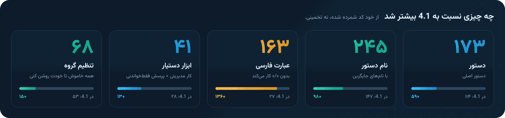
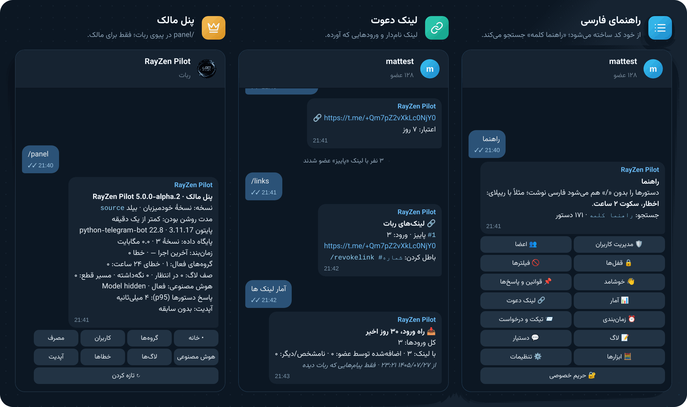
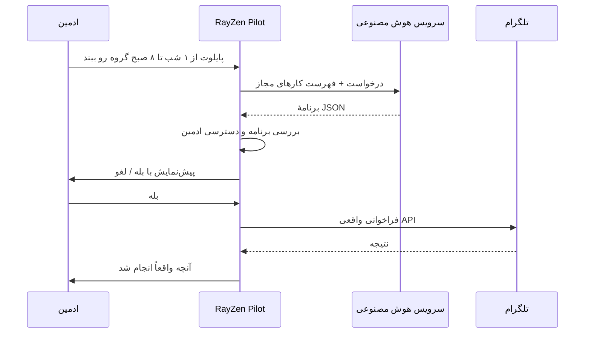
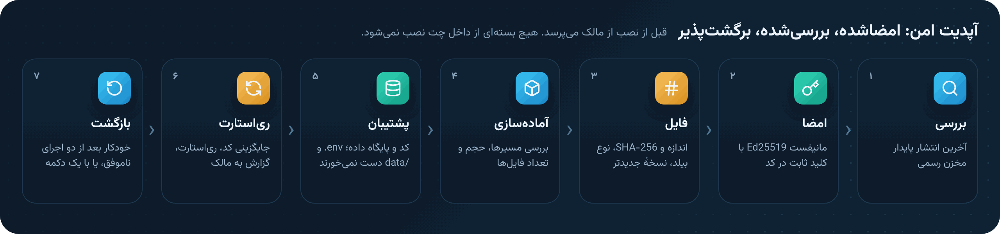

<p align="center">
  
</p>

<p align="center">
  <a href="https://github.com/matttsys/RayZen-Pilot/releases"></a>
  
  
  
  
  
  
  <a href="LICENSE"></a>
</p>

<p align="center">
  <a href="README.md">English</a> &nbsp;·&nbsp; <b>فارسی</b>
</p>

<div dir="rtl">

<p align="center">
  <a href="#fa-download">دانلود</a> ·
  <a href="#fa-new">تازه‌ها</a> ·
  <a href="#fa-features">امکانات</a> ·
  <a href="#fa-install">نصب</a> ·
  <a href="#fa-first-run">اولین اجرا</a> ·
  <a href="#fa-configuration">تنظیمات</a> ·
  <a href="#fa-commands">دستورها</a> ·
  <a href="#fa-assistant">دستیار</a> ·
  <a href="#fa-panel">پنل مالک</a> ·
  <a href="#fa-updates">آپدیت امن</a> ·
  <a href="#fa-troubleshooting">رفع مشکل</a>
</p>

---

‏RayZen Pilot ربات مدیریت گروه تلگرام است و از اول برای فارسی ساخته شده: ادمین روی پیام کسی ریپلای می‌کند و می‌نویسد «سکوت ۲ ساعت»، همین. به‌جز SQLite به هیچ سرویس دیگری نیاز ندارد. وقتی به گروه اضافه یا ادمین می‌شود هیچ پیامی نمی‌فرستد، هیچ تنظیمی را عوض نمی‌کند و همهٔ فیلترهایش خاموش‌اند تا ادمین بخواهد.

</div>

> [!WARNING]
> **این یک پیش‌انتشار است (‎`5.0.0-alpha.2`‎).** همهٔ آزمون‌های خودکار روی شبیه‌ساز آفلاین تلگرام پاس شده‌اند، ولی آزمون زنده در گروه واقعی هنوز انجام نشده است. روی گروه‌های مهم با احتیاط استفاده کنید. نسخهٔ پایدار [4.1.0](https://github.com/matttsys/RayZen-Pilot/releases/tag/v4.1.0) همچنان در دسترس است.

<div dir="rtl">

<a name="fa-download"></a>

## دانلود

| فایل | برای |
|---|---|
| [**rayzen-pilot-v5.0.0-alpha.2-omni-selfhost.zip**](https://github.com/matttsys/RayZen-Pilot/releases/download/v5.0.0-alpha.2/rayzen-pilot-v5.0.0-alpha.2-omni-selfhost.zip) | **نسخهٔ عمومی** برای اجرای ربات خودت: هاست پنل، VPS و داکر. بدون اجبار عضویت در کانال، بدون تماس پنهان، بدون تله‌متری. |
| [rayzen-pilot-v5.0.0-alpha.2-omni-owner-hosted.zip](https://github.com/matttsys/RayZen-Pilot/releases/download/v5.0.0-alpha.2/rayzen-pilot-v5.0.0-alpha.2-omni-owner-hosted.zip) | فقط برای ربات میزبانی‌شدهٔ خود پروژه. روی ‎`/start`‎ در پیوی، درخواست عضویت در ‎[@Rzroot](https://t.me/Rzroot)‎ نشان می‌دهد. |
| [manifest.json](https://github.com/matttsys/RayZen-Pilot/releases/download/v5.0.0-alpha.2/rayzen-pilot-v5.0.0-alpha.2-omni-manifest.json) · [manifest.json.sig](https://github.com/matttsys/RayZen-Pilot/releases/download/v5.0.0-alpha.2/rayzen-pilot-v5.0.0-alpha.2-omni-manifest.json.sig) | مانیفست امضاشده با Ed25519. ‎`/update`‎ و ‎`/update inbox`‎ با همین دو فایل زیپ را تأیید می‌کنند. |
| [SHA256SUMS.txt](https://github.com/matttsys/RayZen-Pilot/releases/download/v5.0.0-alpha.2/rayzen-pilot-v5.0.0-alpha.2-omni-SHA256SUMS.txt) | هش همهٔ فایل‌ها |
| [RELEASE-NOTES.md](https://github.com/matttsys/RayZen-Pilot/releases/download/v5.0.0-alpha.2/rayzen-pilot-v5.0.0-alpha.2-omni-RELEASE-NOTES.md) | شناسهٔ بیلد و نتیجهٔ آزمون‌های همین فایل‌ها |

هر زیپ یک پوشه به نام نسخه دارد و همه‌چیز در آن است: خود ربات، نصب‌کنندهٔ VPS، فایل‌های داکر و مستندات. در مخزن، همین کد به دو پوشه تقسیم شده است:

| پوشه | چه دارد |
|---|---|
| [‎`host/`‎](https://github.com/matttsys/RayZen-Pilot/tree/main/host) | فقط ربات، برای هاست پنل (نصب با Git از داخل پنل) |
| [‎`vps/`‎](https://github.com/matttsys/RayZen-Pilot/tree/main/vps) | همان ربات به‌همراه ‎`install.sh`‎، سرویس systemd، دستور ‎`rayzen`‎ و فایل‌های داکر |
| [‎`docs/`‎](docs) | [فهرست کامل دستورها](docs/COMMANDS.fa.md) و [نمونهٔ پاسخ‌های واقعی ربات](docs/EXAMPLES.fa.md)؛ هر دو از روی کد ساخته می‌شوند |

راه بررسی امضا و هش زیپ‌ها: [SECURITY.md](SECURITY.md) · نسخه‌های قبلی: [Releases](https://github.com/matttsys/RayZen-Pilot/releases) · تغییرات: [CHANGELOG.md](CHANGELOG.md)

<a name="fa-new"></a>

## تازه‌ها

### در ‎`5.0.0-alpha.2`‎

- **رفع خطای ‎`/update`‎.** آپدیت با پیام «دانلود ناقص یا ناموفق» (مثلاً ‎`9617/2270 bytes`‎) متوقف می‌شد. GitHub پاسخ‌های API را فشرده (gzip) می‌فرستد و بررسی دقیق اندازه با عدد فشرده مقایسه می‌کرد. حالا آپدیت‌کننده پاسخ غیرفشرده می‌خواهد و سقف اندازه روی بایت‌های باز‌شده اعمال می‌شود. بقیهٔ بررسی‌ها (امضا، کلید ثابت، هش، نسخه و نوع بیلد) دست نخورده‌اند. همچنین انتشار پایدار قدیمی‌تر و بدون امضای 4.1.0 دیگر «انتشار امضاشده نیست» نشان داده نمی‌شود، بلکه «نسخهٔ جدیدتری نیست».
- **دستور لینک با مدت.** «لینک جدید پاییز ۷ روز» دیگر «۷ روز» را جزو اسم لینک حساب نمی‌کند.
- **فهرست‌ها در گروه‌های انگلیسی** (آمار، خوشامد، وضعیت قفل و…) با ویرگول انگلیسی جدا می‌شوند، نه «،».
- **این README** با گرافیک‌های تازه و چیدمان نسخهٔ 4.

### در v5 نسبت به 4.1



همهٔ عددها از خود کد شمرده شده‌اند. مهم‌ترین تغییرها:

- **دستور فارسی، مسیر اصلی.** ۱۶۳ عبارت بدون «/» کار می‌کند؛ فقط اول پیام و فقط برای کسی که اجازه دارد. فوروارد، نقل‌قول و کد هیچ‌وقت دستور حساب نمی‌شود.
- **آمار و لینک دعوت.** شمار پیام‌ها، ساعت‌های شلوغ، ورود و خروج، فعال‌ترین‌ها، لینک نام‌دار و ورود از هر لینک.
- **دستیار بدون ‎`/ai`‎.** با اسمش («پایلوت»)، منشن یا ریپلای. پرسش فقط‌خواندنی از دادهٔ همین گروه و ابزار متن (خلاصه، ترجمه، غلط‌گیری، توضیح).
- **پنل مالک و آپدیت امضاشده.** ‎`/panel`‎ در پیوی، با آپدیت تأییدشده، پشتیبان و بازگشت خودکار.
- **ابزارها.** تاریخ شمسی، ماشین‌حساب، تبدیل واحد، شمارش معکوس، تایمر، AFK.
- **مجوز AGPL-3.0** با فایل NOTICE. نسخه‌های 4.x همان MIT می‌مانند.

فهرست کامل: [CHANGELOG.md](CHANGELOG.md)

<a name="fa-features"></a>

## امکانات


### وقتی به گروه اضافه می‌شود

| بخش | پیش‌فرض |
|---|---|
| **پیام در گروه** | هیچ. نه وقتی اضافه می‌شود و نه وقتی ادمین می‌شود. |
| **پیام‌ها** | هیچ پیامی پاک نمی‌شود. همهٔ فیلترها خاموش‌اند. |
| **دسترسی‌ها** | چیزی عوض نمی‌شود. قفل فقط با درخواست ادمین اعمال می‌شود و با باز کردنش همه‌چیز به حالت قبل برمی‌گردد. |
| **اعضا** | عضو عادی نه با دستور فارسی، نه با ‎`/`‎ و نه از راه دستیار نمی‌تواند کسی را مدیریت کند. |
| **آمار** | فقط شمارش، از لحظه‌ای که ربات در گروه است. ‎`/statsmode off`‎ خاموشش می‌کند. |
| **دستیار** | بدون ‎`AI_API_KEY`‎ خاموش است و بقیهٔ امکانات کامل کار می‌کنند. |
| **دادهٔ نسخهٔ قبل** | قوانین، یادداشت‌ها، اخطارها و کلیدواژه‌ها منتقل می‌شوند. فیلترهای قدیمی خاموش می‌مانند و در ‎`/legacy`‎ فهرست می‌شوند. |

<a name="fa-chat"></a>

## داخل چت




متن‌ها خروجی واقعی خود ربات‌اند که روی شبیه‌ساز آفلاین تلگرام اجرا شده و در قاب تلگرام نمایش داده شده‌اند. در صحنهٔ دستیار، برنامهٔ مدل از یک سرویس آزمایشی آمده؛ پیش‌نمایش، دکمهٔ تأیید و نتیجه همان پیام‌های ربات‌اند. نمونه‌های بیشتر: [docs/EXAMPLES.fa.md](docs/EXAMPLES.fa.md)

<a name="fa-install"></a>

## نصب


| | هاست ربات (پنل) | سرور مجازی | داکر |
|---|---|---|---|
| **فایل** | زیپ ‎`selfhost`‎ | زیپ ‎`selfhost`‎ یا ‎`git clone`‎ (پوشهٔ ‎`vps/`‎) | زیپ ‎`selfhost`‎ یا ‎`git clone`‎ (پوشهٔ ‎`vps/`‎) |
| **نیازمندی** | سرور پایتون 3.10 به بالا روی پنل | لینوکس با systemd و دسترسی root | Docker و Compose |
| **تنظیم** | ویرایش ‎`.env`‎ در فایل منیجر | نصب‌کنندهٔ تعاملی | ‎`configure.py`‎ یا ویرایش ‎`.env`‎ |
| **اجرای دوباره بعد از کرش** | سوپروایزر داخلی ‎`app.py`‎ | systemd | Compose |
| **آپدیت** | ‎`/update`‎ در تلگرام یا زیپ جدید | ‎`/update`‎ یا ‎`sudo rayzen update`‎ | ساختن دوبارهٔ ایمیج |

قبل از شروع این‌ها را آماده کن:

1. توکن ربات از ‎[@BotFather](https://t.me/BotFather)‎
2. آیدی عددی تلگرام خودت (به ‎[@userinfobot](https://t.me/userinfobot)‎ پیام ‎`/start`‎ بده)
3. اختیاری: کلید API یک سرویس سازگار با OpenAI، اگر دستیار را می‌خواهی

### هاست ربات (پنل)

روی هاست‌های مبتنی بر Pterodactyl که سرور پایتون دارند کار می‌کند.

1. یک سرور با egg **Python** نسخهٔ 3.10 یا بالاتر بساز.
2. زیپ [‎`selfhost`‎](https://github.com/matttsys/RayZen-Pilot/releases/download/v5.0.0-alpha.2/rayzen-pilot-v5.0.0-alpha.2-omni-selfhost.zip) را در بخش **Files** آپلود کن و **Unarchive** را بزن. یک پوشه با نام نسخه ساخته می‌شود.
3. وارد آن پوشه شو، همه را انتخاب کن و با **Move** به ‎`../`‎ منتقل کن تا ‎`app.py`‎ در پوشهٔ اصلی باشد، نه داخل زیرپوشه.
4. اسم ‎`.env.example`‎ را به ‎`.env`‎ تغییر بده و ‎`BOT_TOKEN`‎ و ‎`OWNER_ID`‎ را پر کن.
5. در **Startup** مطمئن شو *App py file* روی ‎`app.py`‎ و *Requirements file* روی ‎`requirements.txt`‎ باشد. بعد **Start** را بزن. وقتی ربات آنلاین شود، در کنسول ‎`up as @yourbot`‎ چاپ می‌شود.

> اگر قبل از مرحلهٔ ۴ دکمهٔ Start را بزنی، ربات خودش ‎`.env`‎ را از روی ‎`.env.example`‎ می‌سازد و با یک پیام می‌گوید چه چیزی را باید پر کنی.

در بیشتر پنل‌ها پکیج‌ها داخل ‎`.local`‎ نصب می‌شوند و ‎`app.py`‎ خودش پیدایشان می‌کند. اگر پنل پورت بدهد، روی همان پورت یک health check با خروجی JSON در دسترس است.

<details>
<summary><b>نصب با Git به‌جای زیپ</b></summary>

اگر egg پایتون پنلت فیلد *Git Repo Address* دارد، پنل می‌تواند خودش مخزن را کلون کند. این مقدارها را در **Startup** بگذار و بعد از بخش **Settings** سرور را Reinstall کن:

| متغیر | مقدار |
|---|---|
| Git Repo Address | ‎`https://github.com/matttsys/RayZen-Pilot`‎ |
| Install Branch | ‎`main`‎ |
| User Uploaded Files | ‎`0`‎ |
| App py file | ‎`host/app.py`‎ |
| Requirements file | ‎`host/requirements.txt`‎ |
| Auto Update | ‎`0`‎ (آپدیت را با ‎`/update`‎ انجام بده) |

شاخهٔ ‎`main`‎ الان کد همین پیش‌انتشار v5 است. بعد از Reinstall، در **Files** وارد ‎`host/`‎ شو، اسم ‎`.env.example`‎ را به ‎`.env`‎ تغییر بده، پرش کن و **Start** را بزن. ‎`.env`‎ و ‎`data/`‎ در git نیستند، پس با آپدیت دست نمی‌خورند.

</details>

### سرور مجازی (VPS)

با زیپ ریلیز:

</div>

```bash
sudo apt install -y unzip curl     # Debian/Ubuntu, if they're missing
curl -LO https://github.com/matttsys/RayZen-Pilot/releases/download/v5.0.0-alpha.2/rayzen-pilot-v5.0.0-alpha.2-omni-selfhost.zip
unzip rayzen-pilot-v5.0.0-alpha.2-omni-selfhost.zip
cd rayzen-pilot-v5.0.0-alpha.2-omni-selfhost
sudo bash install.sh
```

<div dir="rtl">

یا با git:

</div>

```bash
git clone https://github.com/matttsys/RayZen-Pilot.git
cd RayZen-Pilot/vps
sudo bash install.sh
```

<div dir="rtl">

نصب‌کننده این کارها را انجام می‌دهد:

- پایتون 3.10 به بالا را پیدا می‌کند یا نصبش می‌کند (apt، dnf، yum، pacman، zypper)
- کاربر سیستمی ‎`rayzen`‎ را می‌سازد و ربات را در ‎`/opt/rayzen-pilot`‎ با virtualenv خودش نصب می‌کند
- توکن، آیدی مالک، کلید هوش مصنوعی و منطقهٔ زمانی را می‌پرسد. توکن را با تلگرام چک می‌کند و اگر به ربات پیام بدهی، آیدی‌ات را خودش پیدا می‌کند.
- سرویس systemd با نام ‎`rayzen-pilot`‎ و دستور ‎`rayzen`‎ را نصب و روشن می‌کند

برای نصب بدون سؤال، مقدارها را به‌صورت متغیر بده:

</div>

```bash
sudo BOT_TOKEN=123456:ABC... OWNER_ID=111222333 AI_API_KEY=sk-... bash install.sh
```

<div dir="rtl">

با ‎`INSTALL_DIR`‎ و ‎`SERVICE_USER`‎ می‌توانی مسیر نصب و کاربر را عوض کنی.

| دستور | کار |
|---|---|
| ‎`rayzen status`‎ | روشن یا خاموش، مدت اجرا، یوزرنیم ربات |
| ‎`rayzen logs`‎ / ‎`rayzen logs -f`‎ | ۱۰۰ خط آخر / دنبال کردن زنده |
| ‎`rayzen start`‎ · ‎`stop`‎ · ‎`restart`‎ | کنترل سرویس |
| ‎`rayzen config`‎ | پرسیدن دوبارهٔ سؤال‌ها و ری‌استارت |
| ‎`rayzen backup`‎ | پشتیبان دیتابیس و ‎`.env`‎ در ‎`/opt/rayzen-pilot/backups`‎ |
| ‎`rayzen update <zip or folder>`‎ | نصب نسخهٔ جدید با حفظ ‎`.env`‎ و داده‌ها |
| ‎`rayzen version`‎ | نسخهٔ نصب‌شده |
| ‎`rayzen uninstall`‎ | حذف سرویس؛ قبل از پاک کردن داده‌ها می‌پرسد |

‏‎`rayzen update`‎ هر فایلی بدهی نصب می‌کند؛ اول امضا را بررسی کن ([SECURITY.md](SECURITY.md)) یا از ‎`/update`‎ در تلگرام استفاده کن که خودش امضا را چک می‌کند.

### داکر

</div>

```bash
cd rayzen-pilot-v5.0.0-alpha.2-omni-selfhost      # or: cd RayZen-Pilot/vps
python3 configure.py                           # or: cp .env.example .env && nano .env
docker compose up -d --build
docker compose logs -f
```

<div dir="rtl">

دیتابیس در volume با نام ‎`pilot-data`‎ می‌ماند. پوشهٔ کد داخل ایمیج برای ربات فقط‌خواندنی است، پس ‎`/update`‎ نسخهٔ جدید را فقط بررسی می‌کند؛ برای نصب، فایل‌ها را جایگزین کن و ‎`docker compose up -d --build`‎ را دوباره اجرا کن.

### اجرا از سورس

این دستورها را در پوشهٔ زیپ، یا داخل ‎`host/`‎ یا ‎`vps/`‎ اجرا کن:

</div>

```bash
python3 -m venv .venv && . .venv/bin/activate     # Windows: .venv\Scripts\activate
pip install -r requirements.txt
cp .env.example .env                              # fill in BOT_TOKEN and OWNER_ID
python app.py
```

<div dir="rtl">

<a name="fa-first-run"></a>

## اولین اجرا در گروه

1. ربات را به گروه اضافه کن و ادمینش کن. ربات در گروه چیزی نمی‌فرستد؛ این عمدی است.
2. فقط دسترسی‌هایی را بده که لازم داری:

   | دسترسی ربات | برای |
   |---|---|
   | بن کاربران (Ban users) | بن، سکوت، اخراج، قفل، قفل شبانه، کپچا |
   | حذف پیام (Delete messages) | فیلترها، ‎`/del`‎، ‎`/purge`‎، ‎`/purgeword`‎ |
   | سنجاق پیام | سنجاق و اطلاعیهٔ سنجاق‌شده |
   | دعوت کاربر با لینک | لینک دعوت، آمار لینک، میز درخواست عضویت |
   | مدیریت تاپیک | ابزار تاپیک (فقط گروه‌های انجمنی) |
   | افزودن ادمین | ‎`/promote`‎ و ‎`/demote`‎ (اختیاری) |
   | فقط ارسال پیام | خوشامد، قوانین، پاسخ‌ها، آمار |

3. «تنظیمات» یا ‎`/settings`‎ را بفرست. «سلامت گروه» یا ‎`/health`‎ دسترسی‌هایی را که هنوز ناقص‌اند نشان می‌دهد.
4. گروه لاگ را وصل کن: یک گروه خصوصی بساز، ربات را در آن ادمین کن، بعد در گروه اصلی ‎`/setlog`‎ بفرست و کدی را که می‌دهد دنبال کن. اگر آیدی گروه لاگ را داری، ‎`/setlog -100…`‎ هم مستقیم کار می‌کند.
5. هر چه لازم داری روشن کن: ‎`/antilink on`‎، ‎`/flood on 6 mute`‎، ‎`/captcha on`‎، «قفل شبانه از ۱ تا ۸».
6. اختیاری: اسم دستیار را با ‎`/ainame`‎ عوض کن (پیش‌فرض «پایلوت»).

ادمین‌ها هم فقط کارهایی را می‌توانند بکنند که خودشان در تلگرام اجازه‌اش را دارند؛ مثلاً سکوت فقط برای ادمینی که «Ban users» دارد، و تنظیمات گروه برای ادمینی که «Change group info» دارد. ربات وقتی ادمین باشد همهٔ پیام‌های گروه را می‌بیند، پس لازم نیست privacy mode را در BotFather عوض کنی.

<a name="fa-configuration"></a>

## تنظیمات

همهٔ تنظیمات در فایل ‎`.env`‎ کنار ‎`app.py`‎ است. فقط دو مورد اول اجباری‌اند.

| کلید | پیش‌فرض | توضیح |
|---|---|---|
| ‎`BOT_TOKEN`‎ | | از ‎[@BotFather](https://t.me/BotFather)‎. **اجباری** |
| ‎`OWNER_ID`‎ | | آیدی عددی تلگرام تو؛ پنل و آپدیت فقط برای همین آیدی است. **اجباری** |
| ‎`AI_BASE_URL`‎ | Nous Portal | هر endpoint سازگار با OpenAI که به ‎`/v1`‎ ختم شود |
| ‎`AI_API_KEY`‎ | خالی | خالی یعنی دستیار خاموش است؛ بقیهٔ امکانات کار می‌کنند |
| ‎`AI_MODEL`‎ | در ‎`.env.example`‎ | شناسهٔ مدل در سرویس‌دهنده |
| ‎`AI_FALLBACK_MODELS`‎ | در ‎`.env.example`‎ | با کاما جدا می‌شوند و به ترتیب امتحان می‌شوند |
| ‎`TZ`‎ | ‎`Asia/Tehran`‎ | منطقهٔ زمانی پیش‌فرض گروه‌های جدید؛ هر گروه با ‎`/timezone`‎ عوضش می‌کند |
| ‎`LOG_CHANNEL`‎ | خالی | آیدی چت برای پیام‌های مالک؛ خالی یعنی پیوی خودت |
| ‎`DB_PATH_PILOT`‎ | ‎`data/pilot.db`‎ | فایل SQLite |
| ‎`LOG_LEVEL`‎ | ‎`INFO`‎ | برای جزئیات بیشتر ‎`DEBUG`‎ |
| ‎`SERVER_PORT`‎ | خالی | پورت health check؛ معمولاً پنل خودش تنظیمش می‌کند |

<details>
<summary><b>محدودیت‌ها و هزینهٔ هوش مصنوعی</b></summary>

| کلید | پیش‌فرض |
|---|---|
| ‎`AI_TIMEOUT_S`‎ | ‎`60`‎ |
| ‎`AI_CONCURRENCY`‎ | ‎`2`‎ |
| ‎`AI_USER_PER_10MIN`‎ | ‎`8`‎ |
| ‎`AI_GROUP_PER_HOUR`‎ | ‎`30`‎ |
| ‎`AI_GLOBAL_PER_DAY`‎ | ‎`3000`‎ |
| ‎`AI_EXTRA_BODY`‎ | JSON اضافه برای هر درخواست، مثل ‎`{"temperature":0.2}`‎ |
| ‎`AI_PRICE_IN_PER_M`‎ · ‎`AI_PRICE_OUT_PER_M`‎ | قیمت هر میلیون توکن، فقط برای تخمین هزینه در ‎`/panel`‎. اگر نمی‌دانی خالی بگذار. |

</details>

<details>
<summary><b>آپدیت و فورک</b></summary>

| کلید | توضیح |
|---|---|
| ‎`UPDATE_REPO`‎ | پیش‌فرض ‎`matttsys/RayZen-Pilot`‎. فقط اگر از فورک خودت انتشار امضاشده می‌دهی عوضش کن. |
| ‎`UPDATE_PUBKEY`‎ | کلید عمومی امضای فورک. خالی یعنی کلید ثابت پروژهٔ اصلی. |
| ‎`SOURCE_URL`‎ | فقط فورک‌ها: لینک کد منبع نسخهٔ تغییریافتهٔ تو (AGPL، بخش ۱۳). در ‎`/start`‎ پیوی نشان داده می‌شود. |

</details>

<a name="fa-commands"></a>

## دستورها

### به فارسی، بدون اسلش

با ریپلای روی پیام کاربر:

</div>

```text
سکوت ۲ ساعت          اخطار تبلیغ          بن             رفع سکوت
حذف                  سنجاق                 اعتماد         مشخصات
```

<div dir="rtl">

بدون ریپلای:

</div>

```text
راهنما               راهنما لینک          آمار            فعال ترین ها
قفل عکس ۳۰ دقیقه     قفل شبانه از ۱ تا ۸   لینک جدید       سلامت گروه
تاریخ                حساب کن ۲+۳*۴         یادم بنداز ۱۰ دقیقه چای
```

<div dir="rtl">

عبارت فارسی فقط وقتی اجرا می‌شود که اول پیام باشد و فرستنده اجازه‌اش را داشته باشد. پیام فورواردشده، نقل‌قول و کد هیچ‌وقت دستور حساب نمی‌شود، و عضو عادی با نوشتن «بن» کاری انجام نمی‌دهد. ‎`راهنما کلمه`‎ در راهنما جستجو می‌کند و ‎`/help`‎ فقط دستورهایی را نشان می‌دهد که خواننده می‌تواند اجرا کند.

### همهٔ بخش‌ها

هر دستور شکل ‎`/`‎ هم دارد. جدول کامل با همهٔ نام‌های جایگزین، عبارت‌های فارسی و سطح دسترسی: **[docs/COMMANDS.fa.md](docs/COMMANDS.fa.md)**

| بخش | نمونه‌ها |
|---|---|
| 🛡 مدیریت کاربران | ‎`/ban`‎ ‎`/tban 2h`‎ ‎`/unban`‎ ‎`/mute`‎ ‎`/tmute 30m`‎ ‎`/unmute`‎ ‎`/kick`‎ ‎`/warn`‎ ‎`/warns`‎ ‎`/rmwarn`‎ ‎`/promote`‎ ‎`/demote`‎ ‎`/info`‎ ‎`/trust`‎ |
| 👥 اعضا | ‎`/seen`‎ ‎`/checkmember`‎ ‎`/namehistory`‎ ‎`/banlist`‎ ‎`/mutelist`‎ ‎`/membercount`‎ ‎`/adminrights`‎ ‎`/banchannel`‎ ‎`/purgeuser`‎ |
| 🔒 قفل‌ها | ‎`/lock photos 30m`‎ ‎`/unlock`‎ ‎`/lockdown 1h`‎ ‎`/lockstatus`‎ ‎`/night 01:00 08:00`‎ ‎`/slowmode`‎ ‎`/cooldown on 30`‎ |
| 🚫 فیلترها | ‎`/antilink`‎ ‎`/antiforward`‎ ‎`/antichannel`‎ ‎`/antitabchi`‎ ‎`/antimention`‎ ‎`/antidupe`‎ ‎`/flood on 6 mute`‎ ‎`/captcha on`‎ ‎`/antiraid on`‎ ‎`/probation`‎ ‎`/block`‎ ‎`/why`‎ ‎`/pause`‎ ‎`/resume`‎ |
| 👋 خوشامد | ‎`/setwelcome`‎ ‎`/welcome on\|off\|preview`‎ ‎`/setgoodbye`‎ ‎`/cleanwelcome on`‎ ‎`/cleanservice on`‎ |
| 📌 قوانین و پاسخ‌ها | ‎`/rules`‎ ‎`/setrules`‎ ‎`/save name text`‎ ‎`/get name`‎ یا ‎`#name`‎ ‎`/faq`‎ ‎`/keyword`‎ ‎`/filter`‎ ‎`/autoanswer on`‎ |
| 📊 آمار | ‎`/stats`‎ ‎`/mystats`‎ ‎`/userstats`‎ ‎`/top`‎ ‎`/hours`‎ ‎`/joins`‎ ‎`/newmembers`‎ ‎`/leavers`‎ ‎`/inactive`‎ ‎`/topadders`‎ ‎`/cohort`‎ ‎`/statsreport`‎ |
| 🔗 لینک دعوت | ‎`/newlink`‎ ‎`/requestlink`‎ ‎`/links`‎ ‎`/linkstats`‎ ‎`/revokelink`‎ ‎`/mylink`‎ ‎`/memberlinks`‎ ‎`/topinviters`‎ |
| ⏰ زمان‌بندی | ‎`/announce 21:00 text`‎ ‎`/announce daily 09:00 text`‎ ‎`/remind 2h text`‎ ‎`/poll q \| a \| b`‎ ‎`/event tomorrow 20:00 title`‎ |
| 📨 تیکت و درخواست | ‎`/contact text`‎ ‎`/tickets`‎ ‎`/treply id text`‎ ‎`/appeal`‎ ‎`/report`‎ ‎`/joindesk on`‎ ‎`/joinquestion`‎ ‎`/requests`‎ ‎`/topic`‎ |
| 📝 لاگ | ‎`/setlog`‎ ‎`/linklog code`‎ ‎`/logstatus`‎ ‎`/logtest`‎ ‎`/logrepair`‎ ‎`/unsetlog`‎ |
| 💬 دستیار | ‎`/ai`‎ ‎`/summarize`‎ ‎`/translate`‎ ‎`/fixtext`‎ ‎`/explain`‎ ‎`/forgetchat`‎ ‎`/ainame`‎ |
| 🧮 ابزارها | ‎`/jalali`‎ ‎`/gregorian`‎ ‎`/time`‎ ‎`/calc`‎ ‎`/convert`‎ ‎`/countdown`‎ ‎`/daysbetween`‎ ‎`/timer`‎ ‎`/choose`‎ ‎`/random`‎ |
| ⚙️ تنظیمات | ‎`/settings`‎ ‎`/health`‎ ‎`/history`‎ ‎`/undo id`‎ ‎`/case 12`‎ ‎`/backup`‎ ‎`/restore`‎ ‎`/clone`‎ ‎`/digest`‎ ‎`/lang fa\|en`‎ ‎`/timezone`‎ ‎`/afk`‎ ‎`/botclean`‎ |
| 🔐 حریم خصوصی | ‎`/privacy`‎ ‎`/retention 90`‎ ‎`/exportdata`‎ ‎`/resetdata`‎ · اعضا: ‎`/mydata`‎ ‎`/forgetme`‎ |
| 🛠 مالک ربات | ‎`/panel`‎ ‎`/update`‎ (فقط در پیوی) |

مدت‌زمان: ‎`30m`‎، ‎`2h`‎، ‎`1d`‎، ‎`1w`‎ یا فارسی، مثل «۲ ساعت»، «۲ ساعت دیگه»، «هر ۶ ساعت». هدف: ریپلای روی پیام، آیدی عددی یا ‎`@username`‎.

<details>
<summary><b>پاک کردن پیام‌ها با یک کلمه: ‎<code>/purgeword</code>‎</b></summary>

‏‎`/purgeword متین`‎ (یا «حذف کلمه متین») همهٔ پیام‌های ۴۸ ساعت اخیر را که این کلمه را دارند پاک می‌کند؛ از هر کسی، حتی ادمین‌ها.

- شکل‌های چسبیده مثل «متینو»، «متینه» و «متین‌جان» هم پیدا می‌شوند. «ي/ی»، «ك/ک»، اعراب و نیم‌فاصله فرقی نمی‌کنند. «ثمتین» پیدا نمی‌شود.
- چند املا با هم: ‎`/purgeword متین، matin`‎
- همیشه اول می‌پرسد: «۱۲ پیام با «متین» از ۴ نفر در ۴۸ ساعت اخیر. پاک شوند؟» فقط همان ادمینی که دستور را داده می‌تواند تأیید کند.
- خودت و ربات باید دسترسی **حذف پیام** داشته باشید.
- تلگرام به ربات اجازهٔ جستجو در گروه و پاک کردن پیام قدیمی‌تر از ۴۸ ساعت را نمی‌دهد؛ برای همین ربات یک نمایهٔ ۴۸ ساعته از کلمه‌ها نگه می‌دارد ([داده و حریم خصوصی](#fa-privacy)). ‎`/purgeword off`‎ خاموشش و پاکش می‌کند.

</details>

<a name="fa-assistant"></a>

## دستیار

اگر ‎`AI_API_KEY`‎ تنظیم شده باشد:

| بخش | چطور کار می‌کند |
|---|---|
| **صدا زدن** | پیامی که با اسم دستیار شروع شود (پیش‌فرض «پایلوت»)، منشن ربات، ریپلای روی جواب دستیار، یا ‎`/ai`‎. در پیوی ربات هر پیام عادی به دستیار می‌رسد. |
| **کار مدیریتی** | بن، سکوت، اخطار، قفل، قفل شبانه، خوشامد، قوانین، فیلتر، اطلاعیه، یادآوری، نظرسنجی، سنجاق، حذف کلمه و… . مدل فقط پیشنهاد می‌دهد؛ اجرا با همان سرویس دستورهای معمولی و با دسترسی همان کسی است که پرسیده. |
| **پرسش از دادهٔ گروه** | فقط‌خواندنی: آمار، فعال‌ترین‌ها، قوانین، ادمین‌ها؛ و برای ادمین‌ها مشخصات یک عضو، اقدام‌های اخیر، ورود و خروج، اعضای غیرفعال و تنظیمات. همیشه با ذکر اینکه ثبت از کی شروع شده. |
| **ابزار متن** | «خلاصه کن»، «ترجمه کن»، «غلط گیری» و «توضیح بده» روی پیام ریپلای‌شده. |
| **حافظه** | شش نوبت آخر گفتگوی هر نفر تا ۳۰ دقیقه به مدل داده می‌شود و بعد از یک روز پاک می‌شود. «فراموش کن» همان لحظه پاکش می‌کند. |
| **محدودیت** | سقف برای هر نفر، هر گروه و کل روز (در ‎`.env`‎). نام مدل و سرویس هیچ‌جا نشان داده نمی‌شود؛ همیشه ‎`Model hidden`‎. |

</div>



<div dir="rtl">

- فقط کارهای یک فهرست مشخص اجرا می‌شوند و هر کدام از همان بررسی دسترسی همیشگی رد می‌شود.
- بن، قفل، زمان‌بندی و بقیهٔ کارهای مهم همیشه منتظر **بله** می‌مانند.
- جواب ربات همان چیزی است که تلگرام برگردانده، حتی اگر کار ناموفق بوده باشد.
- دستورهایی که داخل پیام‌ها پنهان شده باشند نادیده گرفته می‌شوند.
- متن پیام‌های گروه برای دستیار ذخیره یا فرستاده نمی‌شود، مگر پیامی که خودت به دستیار می‌دهی یا رویش ریپلای می‌کنی.

<a name="fa-stats"></a>

## آمار و لینک دعوت

- آمار فقط **شمارش** است: تعداد پیام و رسانهٔ هر عضو در هر روز، پیام در هر ساعت، ورود و خروج‌هایی که ربات دیده. متن پیام ذخیره نمی‌شود.
- ربات فقط از وقتی که در گروه است چیزی می‌بیند. همهٔ گزارش‌ها تاریخ شروع ثبت را نشان می‌دهند و «همهٔ اعضا» ادعا نمی‌کنند.
- ‏‎`/newlink`‎ (یا «لینک جدید پاییز ۷ روز») لینک نام‌دار با انقضا یا سقف عضو می‌سازد و ‎`/linkstats`‎ ورود از هر لینک را نشان می‌دهد. ورود از لینک‌هایی که خود ربات ساخته دقیق شمرده می‌شود؛ لینک ادمین‌های دیگر را تلگرام ناقص به ربات می‌دهد.
- «قفل لینک» فقط پیش‌نمایش لینک را با دسترسی‌های تلگرام می‌بندد؛ برای حذف پیام‌های لینک‌دار ‎`/antilink on`‎ را بزن.

<a name="fa-panel"></a>

## پنل مالک

‏‎`/panel`‎ (یا «پنل») فقط برای ‎`OWNER_ID`‎ و فقط در پیوی ربات. هر دکمه دوباره مالک بودن را بررسی می‌کند.

| صفحه | چه نشان می‌دهد |
|---|---|
| **خانه** | نسخه، نوع بیلد، مدت روشن بودن، پایگاه داده، زمان‌بند، صف لاگ، وضعیت دستیار، زمان پاسخ دستورها |
| **گروه‌ها** | گروه‌های فعال و ترک‌شده، آخرین فعالیت، خروج از گروه با تأیید |
| **کاربران و مصرف** | تعداد کاربران دیده‌شده و پرکاربردترین دستورها |
| **هوش مصنوعی** | موفق و ناموفق، نوع خطاها، زمان پاسخ، توکن‌ها (اگر سرویس گزارش کند) و هزینه (فقط اگر قیمت را در ‎`.env`‎ داده باشی) |
| **لاگ‌ها و خطاها** | مسیرهای قطع و راه تعمیر |
| **آپدیت** | بررسی، نصب، بازگشت و آپدیت خودکار |

پنل هیچ توکن، کلید یا متن پیامی نشان نمی‌دهد.

<a name="fa-updates"></a>

## آپدیت امن



- ‏‎`/update`‎ یا دکمهٔ «آپدیت» در پنل آخرین انتشار **پایدار** مخزن رسمی را می‌گیرد، امضای Ed25519 مانیفست را با کلید ثابت داخل کد بررسی می‌کند، اندازه و SHA-256 زیپ را با مانیفست می‌سنجد، نسخهٔ قدیمی‌تر یا بیلد اشتباه را رد می‌کند و بعد می‌پرسد نصب شود یا نه.
- قبل از نصب از کد و پایگاه داده پشتیبان گرفته می‌شود. ‎`.env`‎ و ‎`data/`‎ هیچ‌وقت عوض نمی‌شوند. اگر نسخهٔ جدید دو بار پشت سر هم قبل از آماده شدن از کار بیفتد، کد قبلی خودکار برمی‌گردد.
- ربات از داخل چت هیچ بسته‌ای با pip نصب نمی‌کند. اگر نسخهٔ جدید وابستگی تازه بخواهد، دستور دقیقش را به مالک می‌گوید.
- **آپدیت خودکار** خاموش است تا مالک روشنش کند، و فقط در بازهٔ تعیین‌شده (پیش‌فرض ۴ تا ۵ صبح) کار می‌کند.

| دستور | کار |
|---|---|
| ‎`/update`‎ | صفحهٔ آپدیت: بررسی، نصب، بازگشت، آپدیت خودکار |
| ‎`/update check`‎ | فقط بررسی آخرین انتشار پایدار |
| ‎`/update inbox`‎ | بررسی و نصب از فایل‌هایی که در پیوی برای ربات فرستاده‌ای |
| ‎`/update window 04:00-05:00`‎ | بازهٔ آپدیت خودکار |

### نصب پیش‌انتشار با فایل

‏‎`/update`‎ پیش‌انتشارها (مثل همین نسخه) را از GitHub نمی‌گیرد. برای نصبشان:

1. سه فایل را از [صفحهٔ همین انتشار](https://github.com/matttsys/RayZen-Pilot/releases/tag/v5.0.0-alpha.2) بگیر: زیپ ‎`selfhost`‎ (یا ‎`owner-hosted`‎)، ‎`manifest.json`‎ و ‎`manifest.json.sig`‎.
2. هر سه را در پیوی برای ربات بفرست. ربات هر کدام را با «ذخیره شد» تأیید می‌کند.
3. ‏‎`/update inbox`‎ را بزن. همان بررسی‌های امضا و هش انجام می‌شود و بعد برای نصب تأیید می‌خواهد.

جزئیات امضا و راه بررسی دستی: [SECURITY.md](SECURITY.md)

<a name="fa-upgrading"></a>

## ارتقا و به‌روزرسانی

### از 4.1.0 یا ‎`alpha.1`‎

1. از ‎`data/pilot.db`‎ و ‎`.env`‎ پشتیبان بگیر (‎`rayzen backup`‎ در VPS).
2. فایل‌های جدید را روی قبلی‌ها بریز، یا روی ‎`alpha.1`‎ از [نصب با فایل](#fa-updates) استفاده کن.
3. ‏Start. پایگاه داده خودکار از نسخهٔ ۲ به ۳ می‌رود و قبلش در ‎`data/backups/`‎ پشتیبان گرفته می‌شود.

تغییرات پایگاه داده افزایشی است؛ اگر لازم شد کد 4.1.0 را برگردانی، با پایگاه دادهٔ جدید هم باز می‌شود. دستور ‎`/owner`‎ حالا پنل مالک را باز می‌کند.

| روش نصب | چطور |
|---|---|
| VPS (زیپ) | ‎`sudo rayzen update rayzen-pilot-v5.0.0-alpha.2-omni-selfhost.zip`‎؛ اول پشتیبان می‌گیرد و ‎`.env`‎ و ‎`data/`‎ را نگه می‌دارد. |
| VPS (git) | ‎`cd RayZen-Pilot && git pull && sudo rayzen update vps`‎ |
| پنل (زیپ) | سرور را Stop کن، زیپ جدید را آپلود و Unarchive کن و محتوای پوشه را با بازنویسی به ریشه ببر. ‎`.env`‎ و ‎`data/`‎ داخل زیپ نیستند، پس دست نمی‌خورند. |
| هر دو | از تلگرام: ‎`/update`‎ برای انتشار پایدار، ‎`/update inbox`‎ برای پیش‌انتشار |
| داکر | فایل‌ها را جایگزین کن یا ‎`git pull`‎ بزن، بعد ‎`docker compose up -d --build`‎ |

<a name="fa-architecture"></a>

## معماری


دستورها، دستورهای فارسی، دکمه‌ها و برنامه‌های دستیار همه از یک روتر وارد یک لایهٔ سرویس می‌شوند؛ برای همین رفتار و بررسی دسترسی‌شان یکی است. یک زمان‌سنج هر ۱۵ ثانیه قفل شبانه، یادآوری‌ها، اطلاعیه‌ها و صف لاگ را اجرا می‌کند. زمان‌بندی‌ها در SQLite (حالت WAL) ذخیره می‌شوند و بعد از ری‌استارت درست ادامه پیدا می‌کنند. ‎`app.py`‎ یک سوپروایزر کوچک است که اگر ربات کرش کند با فاصلهٔ افزایشی دوباره اجرایش می‌کند و اگر آپدیتی دو بار پشت سر هم شکست بخورد، کد قبلی را برمی‌گرداند.

</div>

```
RayZen-Pilot/
├── host/                   bot host panel build
│   ├── app.py              entry point, supervisor, update crash guard
│   └── pilot/  shared/  requirements.txt  .env.example
├── vps/                    Linux server build: same bot, plus
│   ├── install.sh          systemd installer
│   ├── configure.py        .env setup wizard
│   ├── deploy/             systemd unit, rayzen command
│   └── Dockerfile  docker-compose.yml
├── docs/                   COMMANDS (en/fa), EXAMPLES (fa), generated from the code
├── assets/                 logo and README images
└── LICENSE  NOTICE  TRADEMARKS.md  SECURITY.md  CHANGELOG.md

pilot/
├── router.py        one entry point for every update
├── fa_commands.py   Persian text commands (longest-phrase match)
├── commands.py      commands, part 1          commands2.py  part 2
├── moderation.py    ban, mute, warn, kick     members.py    member tools
├── locks.py         lock layers, night lock   guards.py     filters
├── activity.py      counters and stats        invites.py    invite links
├── assistant.py     assistant entry points    planner.py    plans and tools
├── owner_panel.py   /panel                    updater.py    signed updates
├── logs.py          log routes and queue      db.py         schema v3, migrations
└── ...
```

<div dir="rtl">

<a name="fa-privacy"></a>

## داده و حریم خصوصی

- **ذخیره می‌شود:** آیدی، نام و یوزرنیم (با سابقهٔ تغییر)، تنظیمات، اخطارها، پرونده‌ها، تاریخچهٔ اقدام‌ها، شمار پیام‌ها، ورود و خروج‌ها، و چیزهایی که آگاهانه برای ربات فرستاده شده (قوانین، یادداشت‌ها، تیکت‌ها، درخواست‌های تجدیدنظر).
- **ذخیره نمی‌شود:** متن پیام‌های گروه. فقط برای ‎`/purgeword`‎ کلمه‌های یکدست‌شدهٔ پیام‌ها ۴۸ ساعت نگه داشته و بعد خودکار پاک می‌شوند.
- اعضا در پیوی ربات: ‎`/mydata`‎ (خروجی) و ‎`/forgetme`‎ (حذف). ادمین‌ها: ‎`/privacy`‎، ‎`/exportdata`‎، ‎`/resetdata`‎ و ‎`/retention 90`‎ برای تعیین مدت نگهداری.
- ‏‎`/backup`‎ تنظیمات گروه را به‌صورت فایل به پیوی‌ات می‌فرستد. با ریپلای ‎`/restore`‎ روی همان فایل برمی‌گردد و با ‎`/clone`‎ به گروه دیگری کپی می‌شود.

<a name="fa-editions"></a>

## نسخه‌ها (Editions)

هر دو زیپ از یک کد ساخته می‌شوند. نسخهٔ ‎`owner-hosted`‎ فقط یک فایل اضافه دارد (‎`pilot/gate.py`‎) که در پیوی، روی ‎`/start`‎، درخواست کوتاهی برای عضویت در ‎[@Rzroot](https://t.me/Rzroot)‎ با دکمهٔ عضویت و «بررسی دوباره» نشان می‌دهد. گروه‌ها، خوشامد، تیکت و اعتراض هیچ‌وقت به عضویت در کانال وابسته نیستند. نسخهٔ ‎`selfhost`‎ این فایل را ندارد و اگر کسی دستی اضافه‌اش کند، بارگذاری نمی‌شود. آپدیت‌کننده هم نوع بیلد را بررسی می‌کند و زیپ نسخهٔ دیگر را نصب نمی‌کند.

<a name="fa-troubleshooting"></a>

## رفع مشکل

| مشکل | راه‌حل |
|---|---|
| ‎`BOT_TOKEN is missing or invalid`‎ | ‎`.env`‎ پر نشده یا کنار ‎`app.py`‎ نیست. |
| ‎`Conflict: terminated by other getUpdates request`‎ | همین توکن جای دیگری هم در حال اجراست. آن یکی را خاموش کن. |
| ربات در گروه به دستورها جواب نمی‌دهد | باید ادمین باشد. «سلامت گروه» یا ‎`/health`‎ دسترسی‌های ناقص را نشان می‌دهد. |
| عضو عادی «بن» می‌نویسد و اتفاقی نمی‌افتد | درست است. دستورهای مدیریتی فقط برای ادمین‌هایی است که همان دسترسی را در تلگرام دارند. |
| لاگ‌ها نمی‌رسند | ‎`/logstatus`‎ وضعیت مسیر را نشان می‌دهد و ‎`/logtest`‎ (یا ‎`/logrepair`‎) آن را آزمایش و در صورت امکان درست می‌کند. ربات باید در گروه لاگ هم ادمین باشد. |
| پیام‌ها پاک می‌شوند و کسی نمی‌داند چرا | ‎`/why`‎ فیلترهای روشن و حذف‌های اخیر را نشان می‌دهد. ‎`/pause`‎ همهٔ فیلترها را فوراً متوقف می‌کند. |
| دستیار جواب نمی‌دهد | ‎`AI_API_KEY`‎ خالی است یا رد شده. ‎`/panel`‎ ← «هوش مصنوعی» وضعیت و نوع خطا را نشان می‌دهد. |
| ‎`/update`‎: «دانلود ناقص یا ناموفق» | خطای ‎`alpha.1`‎ بود و در ‎`5.0.0-alpha.2`‎ رفع شده. روی ‎`alpha.1`‎، این نسخه را با [نصب با فایل](#fa-updates) یا زیپ نصب کن. |
| ‎`/update`‎ می‌گوید نسخهٔ جدیدتری نیست | ‎`/update`‎ فقط انتشار پایدار را می‌گیرد. پیش‌انتشار را با ‎`/update inbox`‎ نصب کن. |
| خطای ‎`ModuleNotFoundError: telegram`‎ روی پنل | وابستگی‌ها نصب نشده‌اند. *Requirements file* را روی ‎`requirements.txt`‎ بگذار و ری‌استارت کن. |
| ساعت‌ها اشتباه‌اند | در گروه ‎`/timezone Asia/Tehran`‎ بفرست. ‎`TZ`‎ در ‎`.env`‎ پیش‌فرض گروه‌های جدید است. |

## محدودیت‌ها

- آزمون زندهٔ تلگرام برای این پیش‌انتشار هنوز انجام نشده؛ نتیجهٔ آزمون‌ها روی شبیه‌ساز آفلاین است.
- ربات تاریخچهٔ پیام‌های قبل از ورودش را نمی‌بیند (محدودیت Bot API). اگر ربات ادمین نباشد و Privacy mode روشن باشد، همهٔ پیام‌ها را نمی‌گیرد.
- تلگرام حذف پیام‌های قدیمی‌تر از ۴۸ ساعت را اجازه نمی‌دهد.
- در هر گروه حدود ۲۰ پیام در دقیقه از ربات مجاز است؛ ربات پیام‌هایش را کوتاه و کم نگه می‌دارد.
- آمار و «آخرین بازدید» فقط چیزی است که ربات دیده.
- یک توکن فقط یک نسخهٔ در حال اجرا. نسخهٔ دیگر را اول خاموش کن.

## مجوز و انتساب

- از 5.0.0 مجوز پروژه **GNU AGPL-3.0** است ([LICENSE](LICENSE)). نسخه‌های 4.0.0 و 4.1.0 با MIT منتشر شده‌اند و همان مجوز را نگه می‌دارند.
- به زبان ساده: می‌توانی کپی، تغییر، اجرا و دوباره منتشر کنی. اگر نسخهٔ تغییریافته را منتشر کنی یا به‌صورت رباتی اجرا کنی که دیگران از طریق تلگرام از آن استفاده می‌کنند، باید کد منبع همان نسخه را با همین مجوز در اختیار کاربرانش بگذاری (بخش ۱۳؛ با ‎`SOURCE_URL`‎)، و فایل [NOTICE](NOTICE) و انتساب به پروژهٔ اصلی را نگه داری. این شامل داده‌های کاربران یا برنامه‌های جدای دیگر روی سرورت نمی‌شود.
- ‏AGPL فورک را ممنوع نمی‌کند. سیاست نام و لوگو جداست: [TRADEMARKS.md](TRADEMARKS.md).
- این توضیح مشاورهٔ حقوقی نیست؛ متن کامل مجوز ملاک است.

</div>

---

<p align="center">
  <br>
  <sub>RayZen Pilot 5.0.0-alpha.2 Omni · python-telegram-bot 22.8 · SQLite · <a href="https://github.com/matttsys/RayZen-Pilot">GitHub</a> · <a href="SECURITY.md">امنیت</a> · <a href="CHANGELOG.md">تغییرات</a> · پشتیبانی: <a href="https://t.me/Rzroot">‎@Rzroot‎</a> · <a href="README.md">English</a></sub>
</p>
