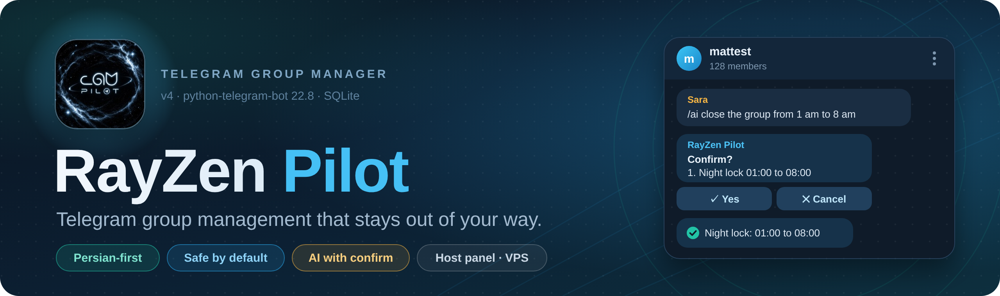
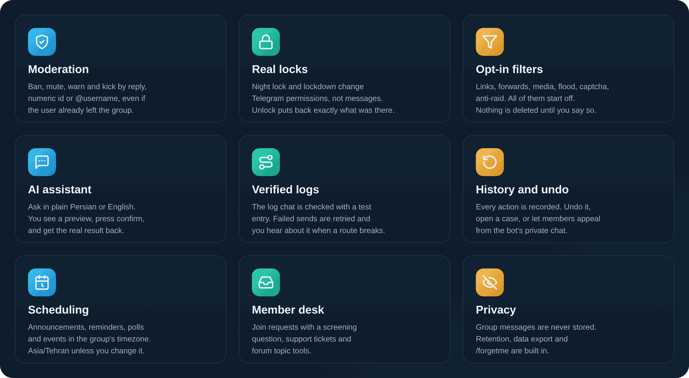
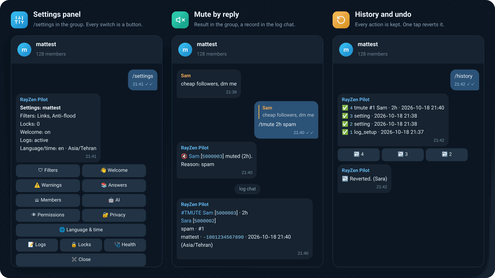
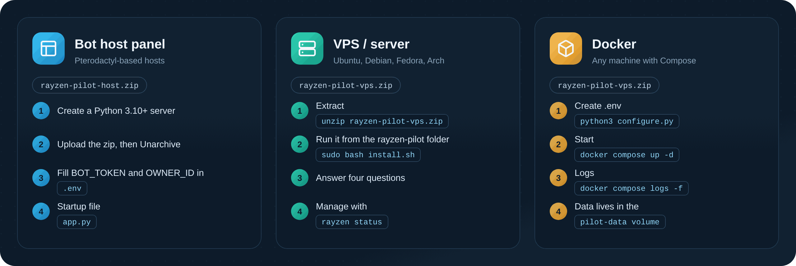
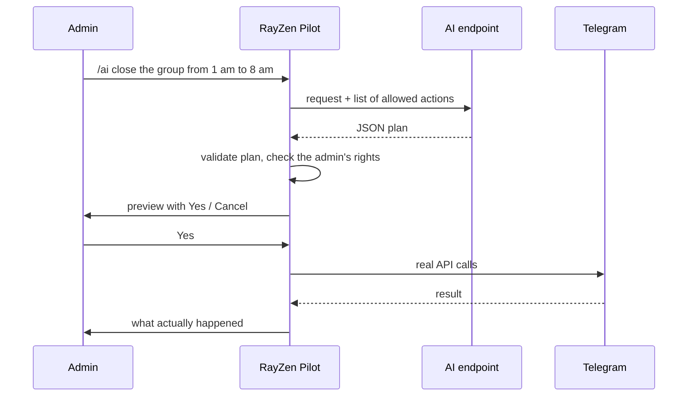
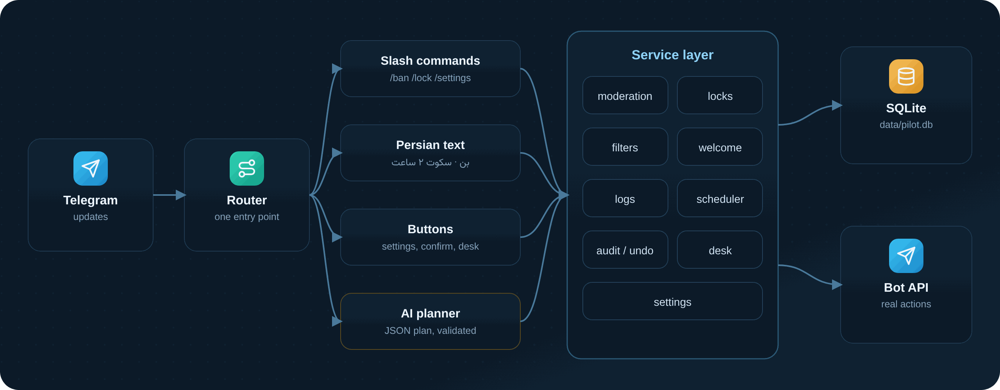

<p align="center">
  
</p>

<p align="center">
  
  
  
  
  
  <a href="https://github.com/matttsys/RayZen-Pilot/releases/latest"></a>
  <a href="https://github.com/matttsys/RayZen-Pilot/blob/main/LICENSE"></a>
</p>

<p align="center">
  <b>English</b> &nbsp;·&nbsp; <a href="README.fa.md">فارسی</a>
</p>

<p align="center">
  <a href="#download">Download</a> ·
  <a href="#features">Features</a> ·
  <a href="#install">Install</a> ·
  <a href="#first-run-in-a-group">First run</a> ·
  <a href="#configuration">Configuration</a> ·
  <a href="#commands">Commands</a> ·
  <a href="#ai-assistant">AI assistant</a> ·
  <a href="#updating">Updating</a> ·
  <a href="#troubleshooting">Troubleshooting</a>
</p>

---

RayZen Pilot manages Telegram groups. It replies in Persian unless you switch a group to English, runs on SQLite with no other services, and starts with every filter off. Nothing changes in your group until an admin asks for it.

## Download

| Folder | Release file | For |
|---|---|---|
| [`host/`](https://github.com/matttsys/RayZen-Pilot/tree/main/host) | [**rayzen-pilot-host.zip**](https://github.com/matttsys/RayZen-Pilot/releases/latest/download/rayzen-pilot-host.zip) | Bot host panels (Pterodactyl Python egg) |
| [`vps/`](https://github.com/matttsys/RayZen-Pilot/tree/main/vps) | [**rayzen-pilot-vps.zip**](https://github.com/matttsys/RayZen-Pilot/releases/latest/download/rayzen-pilot-vps.zip) | Linux servers with systemd, and Docker |
| | [rayzen-pilot-dev.zip](https://github.com/matttsys/RayZen-Pilot/releases/latest/download/rayzen-pilot-dev.zip) | Source with the test suite, for development |

Both folders run the same bot. `vps/` also has the installer, the systemd unit, the `rayzen` command and the Docker files. Each zip has the same bot files as its folder, so use whichever is easier. Checksums are in [SHA256SUMS.txt](https://github.com/matttsys/RayZen-Pilot/releases/latest/download/SHA256SUMS.txt), and older versions are on the [Releases](https://github.com/matttsys/RayZen-Pilot/releases) page.

## Features



### When you add it to a group

| Area | Default |
|---|---|
| **Messages** | Nothing is deleted. Every filter starts off. |
| **Permissions** | Nothing changes. Locks are applied only on request, and unlocking restores what was there before. |
| **Members** | Non-admins can't trigger moderation, by command or through the AI. |
| **First message** | One short note listing any missing admin rights, with Settings and Help buttons. |
| **Older RayZen data** | Rules, notes, warns and keywords are imported. Old filter switches are listed under `/legacy` and stay off. |

## In the chat



These are real replies from the bot, shown in a Telegram-style frame.

## Install



| | Bot host panel | VPS | Docker |
|---|---|---|---|
| **Download** | [`rayzen-pilot-host.zip`](https://github.com/matttsys/RayZen-Pilot/releases/latest/download/rayzen-pilot-host.zip) | [`rayzen-pilot-vps.zip`](https://github.com/matttsys/RayZen-Pilot/releases/latest/download/rayzen-pilot-vps.zip) or `git clone` | [`rayzen-pilot-vps.zip`](https://github.com/matttsys/RayZen-Pilot/releases/latest/download/rayzen-pilot-vps.zip) or `git clone` |
| **Folder in the repo** | `host/` | `vps/` | `vps/` |
| **You need** | A Python 3.10+ server on the panel | Linux with systemd, root access | Docker with Compose |
| **Setup** | Edit `.env` in the file manager | Interactive installer | `configure.py` or edit `.env` |
| **Restarts** | Built-in supervisor + panel | systemd | Compose |

Before you start, have these ready:

1. A bot token from [@BotFather](https://t.me/BotFather)
2. Your numeric Telegram id (send `/start` to [@userinfobot](https://t.me/userinfobot))
3. Optional: an API key for an OpenAI-compatible endpoint, if you want `/ai`

### Bot host panel

Works on Pterodactyl-based hosts that offer a Python server.

1. Create a server with the **Python** egg, version 3.10 or newer.
2. Download [`rayzen-pilot-host.zip`](https://github.com/matttsys/RayZen-Pilot/releases/latest/download/rayzen-pilot-host.zip). In **Files**, upload it and choose **Unarchive**. `app.py` must be in the root folder, not inside a subfolder.
3. Rename `.env.example` to `.env`, then fill in `BOT_TOKEN` and `OWNER_ID`.
4. In **Startup**, check that *App py file* is `app.py` and *Requirements file* is `requirements.txt`. These are the egg defaults.
5. Press **Start**. The console prints `up as @yourbot` when it's online.

> If you press Start before step 3, the bot creates `.env` for you and stops with a message saying what to fill in.

Packages go into `.local` on most panels, and `app.py` finds them automatically. If the panel assigns a port, a JSON health check is served on it.

<details>
<summary><b>Install from Git instead of the zip</b></summary>

If your Python egg has a *Git Repo Address* field, the panel can clone this repo for you. Set these in **Startup**, then reinstall the server from **Settings**:

| Variable | Value |
|---|---|
| Git Repo Address | `https://github.com/matttsys/RayZen-Pilot` |
| Install Branch | `main` |
| User Uploaded Files | `0` |
| App py file | `host/app.py` |
| Requirements file | `host/requirements.txt` |
| Auto Update | `1` to pull the latest code on every start (optional) |

After the reinstall, open `host/` in **Files**, rename `.env.example` to `.env`, fill it in and press **Start**. `.env` and `data/` aren't tracked by git, so updates leave them alone.

</details>

### VPS

With git:

```bash
git clone https://github.com/matttsys/RayZen-Pilot.git
cd RayZen-Pilot/vps
sudo bash install.sh
```

Or with the release zip:

```bash
sudo apt install -y unzip curl     # Debian/Ubuntu, if they're missing
curl -LO https://github.com/matttsys/RayZen-Pilot/releases/latest/download/rayzen-pilot-vps.zip
unzip rayzen-pilot-vps.zip
cd rayzen-pilot
sudo bash install.sh
```

The installer:

- finds Python 3.10+ or installs it (apt, dnf, yum, pacman, zypper)
- creates a `rayzen` system user and installs to `/opt/rayzen-pilot`
- sets up a virtualenv with the dependencies
- asks for the token, owner id, AI key and timezone. It checks the token with Telegram, and it can find your id if you send the bot a message.
- installs the `rayzen-pilot` systemd service and the `rayzen` command

For an unattended install, pass the values as variables:

```bash
sudo BOT_TOKEN=123456:ABC... OWNER_ID=111222333 AI_API_KEY=sk-... bash install.sh
```

`INSTALL_DIR` and `SERVICE_USER` change the location and the user.

| Command | What it does |
|---|---|
| `rayzen status` | Running or stopped, uptime, bot username |
| `rayzen logs` / `rayzen logs -f` | Last 100 lines / follow |
| `rayzen start` · `stop` · `restart` | Service control |
| `rayzen config` | Ask the setup questions again, then restart |
| `rayzen backup` | Database and `.env` to `/opt/rayzen-pilot/backups` |
| `rayzen update <zip or folder>` | Install a new release, keep `.env` and data |
| `rayzen uninstall` | Remove the service. Asks before deleting data. |

### Docker

```bash
git clone https://github.com/matttsys/RayZen-Pilot.git && cd RayZen-Pilot/vps
# or: unzip rayzen-pilot-vps.zip && cd rayzen-pilot
python3 configure.py               # or: cp .env.example .env && nano .env
docker compose up -d
docker compose logs -f
```

The database lives in the `pilot-data` volume. To update, replace the files and run `docker compose up -d --build`.

### From source

Run these inside `host/` or `vps/`:

```bash
python3 -m venv .venv && . .venv/bin/activate     # Windows: .venv\Scripts\activate
pip install -r requirements.txt
cp .env.example .env                              # fill in BOT_TOKEN and OWNER_ID
python app.py
```

## First run in a group

1. Add the bot to the group and promote it to admin.
2. Give it the rights for the features you plan to use:

   | Right | Used for |
   |---|---|
   | Delete messages | Filters, `/del`, `/purge` |
   | Ban users | Ban and mute, group locks, captcha |
   | Pin messages | Pins, pinned announcements |
   | Invite users via link | Join-request desk, invite links |
   | Manage topics | Topic tools (forum groups only) |
   | Add new admins | `/promote` and `/demote` (optional) |

3. Send `/settings`. `/health` shows any rights that are still missing.
4. Connect a log chat. Create a private group, add the bot as admin, then send `/setlog` in the main group and follow the code it gives you. You can also link one directly with `/setlog -100…`.
5. Turn on what you need: `/antilink on`, `/flood on 6 mute`, `/captcha on`, `/night 01:00 08:00`.

Admin bots receive every group message, so you don't need to change privacy mode in BotFather.

## Configuration

Everything is in `.env` next to `app.py`. Only the first two keys are required.

| Key | Default | Notes |
|---|---|---|
| `BOT_TOKEN` | | From @BotFather. **Required.** |
| `OWNER_ID` | | Your numeric Telegram id. **Required.** |
| `AI_BASE_URL` | Nous Portal | Any OpenAI-compatible `/v1` endpoint |
| `AI_API_KEY` | empty | Empty turns `/ai` off. Everything else still works. |
| `AI_MODEL` | see `.env.example` | Model id at your provider |
| `AI_FALLBACK_MODELS` | see `.env.example` | Comma-separated, tried in order |
| `TZ` | `Asia/Tehran` | Default timezone for new groups. Each group can change it with `/timezone`. |
| `LOG_CHANNEL` | empty | Chat id for owner notices. Empty means your private chat. |
| `DB_PATH_PILOT` | `data/pilot.db` | SQLite file |
| `LOG_LEVEL` | `INFO` | `DEBUG` for more detail |
| `SERVER_PORT` | empty | Health check port. Panels usually set this for you. |

<details>
<summary><b>AI limits</b></summary>

| Key | Default |
|---|---|
| `AI_TIMEOUT_S` | `60` |
| `AI_CONCURRENCY` | `2` |
| `AI_USER_PER_10MIN` | `8` |
| `AI_GROUP_PER_HOUR` | `30` |
| `AI_GLOBAL_PER_DAY` | `3000` |
| `AI_EXTRA_BODY` | extra JSON merged into each request, e.g. `{"temperature":0.2}` |

</details>

## Commands

In the bot, `/help` lists every command by section. Here's a summary:

| Area | Commands |
|---|---|
| Members | `/ban` `/tban 2h` `/unban` `/mute` `/tmute 30m` `/unmute` `/kick` `/warn` `/warns` `/rmwarn` `/resetwarns` `/promote` `/demote` `/info` `/id` |
| Messages | `/del` `/purge` `/pin` `/unpin` `/unpinall` `/report` |
| Locks | `/lock [type] [time]` `/unlock` `/lockdown 1h` `/lockstatus` `/night 01:00 08:00` `/slowmode` `/cooldown on 30` |
| Filters | `/antilink` `/antiforward` `/antichannel` `/block photos` `/addblock word` `/blocklist` `/flood on 6 mute` `/captcha on` `/antiraid on` `/cleanservice on` |
| When something goes wrong | `/why` (what was deleted and by which filter) · `/pause` · `/resume` · `/safereset` |
| Welcome | `/setwelcome` `/welcome on\|off\|preview` `/setgoodbye` `/goodbye on\|off` `/cleanwelcome on` |
| Rules and answers | `/rules` `/setrules` `/save name text` `/get name` or `#name` `/faq` `/keyword` `/filter` `/stop` `/autoanswer on` |
| Logs | `/setlog` `/linklog code` `/logstatus` `/logtest` `/unsetlog` |
| History | `/history` `/undo id` `/case 12` `/cases` `/appeals` · members: `/mycases` |
| Scheduling | `/announce 21:00 text` `/announce daily 09:00 text` `/remind 2h text` `/poll q \| a \| b` `/event tomorrow 20:00 title \| place` |
| Admin tools | `/settings` `/health` `/digest daily 22:00` `/backup` `/restore` `/clone -100…` `/watchdog` `/lang fa\|en` `/timezone` |
| Desk | `/contact text` `/tickets` `/treply id text` `/joindesk on` `/joinquestion text` `/joinauto on` `/requests` `/topic` |
| Privacy | `/privacy` `/retention 90` `/exportdata` `/resetdata` · members: `/mydata` `/forgetme` |
| AI | `/ai text`, or mention the bot |

Durations: `30m`, `2h`, `1d`, `1w`. Targets: reply to a message, a numeric id, or `@username`.

**Persian text commands.** Admins can reply to a message with **«بن»**, **«سکوت ۲ ساعت»**, **«رفع سکوت»**, **«اخطار»**, **«اخراج»**, **«حذف»** or **«سنجاق»**, or send **«قفل گروه»**, **«باز کردن گروه»**, **«تنظیمات»** or **«سلامت گروه»** with no slash. Members can use **«قوانین»**, **«راهنما»** and **«آیدی»**.

## AI assistant

Admins can write a request in their own words. The bot turns it into the same actions the commands use and shows a preview before anything happens.



- Only actions on a fixed allowlist can run, and each one goes through the normal permission checks.
- Bans, locks, schedules and other high-impact actions always wait for **Yes**.
- The reply reports what Telegram returned, including failures.
- Members can't trigger moderation, and instructions hidden in messages are ignored.
- The bot never names the model or provider. In the UI it shows `Model hidden`.
- Requests are tagged `user=<telegram id>` for providers that track usage per user.

## Architecture



Commands, Persian text commands, buttons and AI plans all go through one router into one service layer, so they behave the same way. A ticker runs every 15 seconds for night locks, reminders, announcements and the log queue. Schedules are stored in SQLite (WAL mode) and pick up correctly after a restart. `app.py` is a small supervisor that restarts the bot process with backoff if it crashes.

```
RayZen-Pilot/
├── host/                   bot host panel build
│   ├── app.py              entry point and supervisor
│   ├── INSTALL.txt         short panel guide (EN + FA)
│   ├── pilot/  shared/  requirements.txt  .env.example
│   └── data/               created on first run (SQLite)
├── vps/                    Linux server build: same bot, plus
│   ├── install.sh          systemd installer
│   ├── configure.py        .env setup wizard
│   ├── deploy/             systemd unit, rayzen command
│   ├── Dockerfile  docker-compose.yml
│   └── app.py  pilot/  shared/  requirements.txt  .env.example
├── assets/                 logo and README images
└── LICENSE

pilot/
├── router.py       one entry point for every update
├── commands.py     commands, part 1
├── commands2.py    commands, part 2
├── moderation.py   ban, mute, warn, kick
├── locks.py        lock layers, night lock, restore
├── logs.py         log routes, queue, retries
├── ai.py           AI client, planner, safety
├── db.py           schema and migrations
└── ...
```

## Data and privacy

- Group messages are never stored. The bot keeps only settings, actions, warns, cases and what people send to it on purpose (rules, notes, tickets, appeals).
- `/retention 90` sets how many days history is kept. `/exportdata` and `/resetdata` work per group.
- Members can send `/mydata` and `/forgetme` in the bot's private chat.
- `/backup` sends a group's settings to your private chat as a file. Reply to that file with `/restore`, or use `/clone` to copy them to another group.

## Updating

| Setup | How |
|---|---|
| VPS (git) | `cd RayZen-Pilot && git pull && sudo rayzen update vps` |
| VPS (zip) | `sudo rayzen update rayzen-pilot-vps.zip`. It takes a backup first and keeps `.env` and `data/`. |
| Panel (zip) | Stop the server, upload the new `rayzen-pilot-host.zip`, unarchive and overwrite. `.env` and `data/` aren't in the zip, so they stay. |
| Panel (git) | With *Auto Update* set to `1`, restart the server. |
| Docker | `git pull` or replace the files, then `docker compose up -d --build` |

Database migrations run on start. To move from an older RayZen version, put the old database at `data/pilot.db` before the first start. It's backed up before anything is imported.

## Troubleshooting

| Symptom | Fix |
|---|---|
| `BOT_TOKEN is missing or invalid` | `.env` isn't filled in, or it isn't in the same folder as `app.py`. |
| `Conflict: terminated by other getUpdates request` | The same token is running somewhere else. Stop the other copy. |
| The bot ignores commands in the group | It needs to be an admin. `/health` lists missing rights. |
| Log entries don't arrive | Run `/logstatus` and `/logtest`. The bot must be an admin in the log chat. |
| Messages disappear and nobody knows why | `/why` lists active filters and recent deletions. `/pause` stops all filters right away. |
| `/ai` says it's off | `AI_API_KEY` is empty or was rejected. `/owner` in private chat shows the AI status. |
| `ModuleNotFoundError: telegram` on a panel | Dependencies weren't installed. Set *Requirements file* to `requirements.txt` and restart. |
| Times are wrong | `/timezone Asia/Tehran` in the group. `TZ` in `.env` sets the default for new groups. |

## License

MIT with an attribution requirement. You can use, clone, change and redistribute RayZen Pilot, commercially too. If you publish a fork or a modified version, or run it as a public bot or service, credit the original project with a link to [github.com/matttsys/RayZen-Pilot](https://github.com/matttsys/RayZen-Pilot). The full text is in [LICENSE](https://github.com/matttsys/RayZen-Pilot/blob/main/LICENSE).

---

<p align="center">
  <br>
  <sub>RayZen Pilot 4.0.0 · python-telegram-bot 22.8 · SQLite · <a href="https://github.com/matttsys/RayZen-Pilot">GitHub</a> · <a href="README.fa.md">فارسی</a></sub>
</p>
