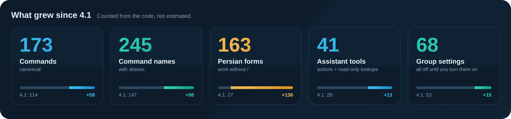
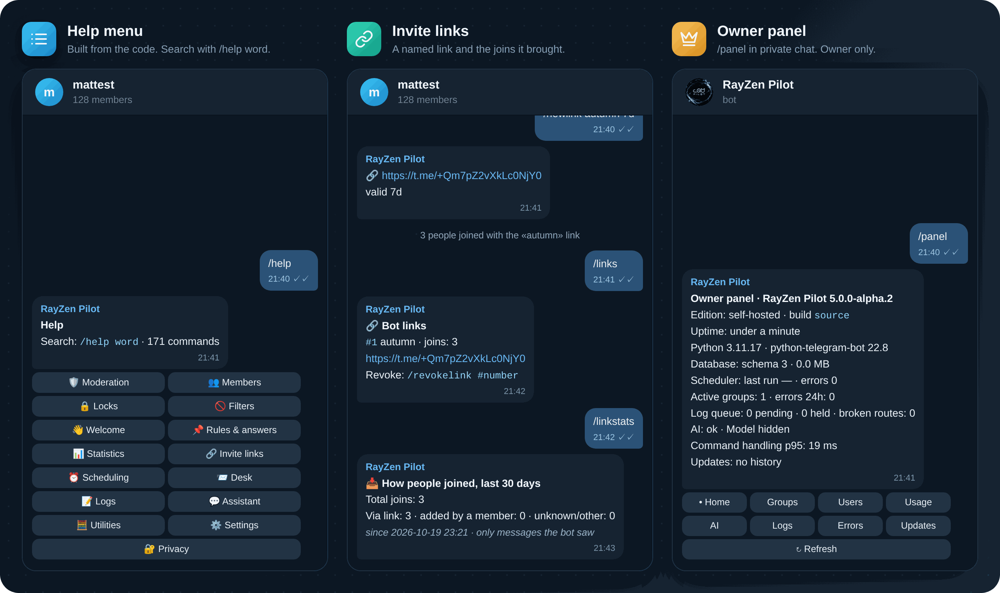
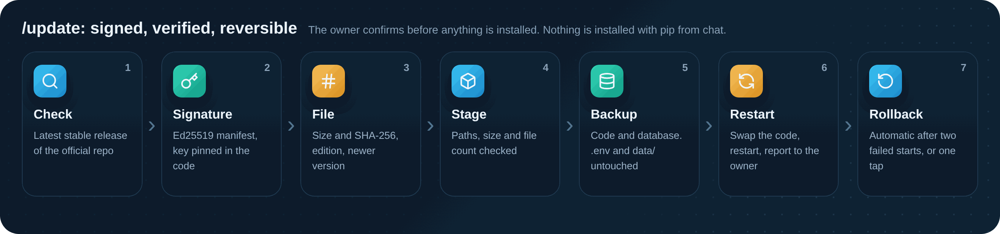

<p align="center">
  
</p>

<p align="center">
  <a href="https://github.com/matttsys/RayZen-Pilot/releases"></a>
  
  
  
  
  
  
  <a href="LICENSE"></a>
</p>

<p align="center">
  <b>English</b> &nbsp;·&nbsp; <a href="README.fa.md">فارسی</a>
</p>

<p align="center">
  <a href="#download">Download</a> ·
  <a href="#whats-new">What's new</a> ·
  <a href="#features">Features</a> ·
  <a href="#install">Install</a> ·
  <a href="#first-run-in-a-group">First run</a> ·
  <a href="#configuration">Configuration</a> ·
  <a href="#commands">Commands</a> ·
  <a href="#assistant">Assistant</a> ·
  <a href="#owner-panel">Owner panel</a> ·
  <a href="#signed-updates">Signed updates</a> ·
  <a href="#troubleshooting">Troubleshooting</a>
</p>

---

RayZen Pilot manages Telegram groups, and it was built for Persian first: an admin replies to someone and writes «سکوت ۲ ساعت» (mute 2 hours), and that's it. It runs on SQLite with no other services. Adding or promoting it posts nothing and changes nothing, and every filter is off until an admin turns it on. Switch a group to English with `/lang en`.

## Download

| File | For |
|---|---|
| [**rayzen-pilot-v5.0.0-alpha.2-omni-selfhost.zip**](https://github.com/matttsys/RayZen-Pilot/releases/download/v5.0.0-alpha.2/rayzen-pilot-v5.0.0-alpha.2-omni-selfhost.zip) | **The public edition** to run your own bot: host panels, VPS and Docker. No channel requirement, no hidden calls, no telemetry. |
| [rayzen-pilot-v5.0.0-alpha.2-omni-owner-hosted.zip](https://github.com/matttsys/RayZen-Pilot/releases/download/v5.0.0-alpha.2/rayzen-pilot-v5.0.0-alpha.2-omni-owner-hosted.zip) | Only the project's own hosted bot. Shows a request to join [@Rzroot](https://t.me/Rzroot) on private `/start`. |
| [manifest.json](https://github.com/matttsys/RayZen-Pilot/releases/download/v5.0.0-alpha.2/rayzen-pilot-v5.0.0-alpha.2-omni-manifest.json) · [manifest.json.sig](https://github.com/matttsys/RayZen-Pilot/releases/download/v5.0.0-alpha.2/rayzen-pilot-v5.0.0-alpha.2-omni-manifest.json.sig) | Ed25519-signed manifest. `/update` and `/update inbox` use these two files to verify the zip. |
| [SHA256SUMS.txt](https://github.com/matttsys/RayZen-Pilot/releases/download/v5.0.0-alpha.2/rayzen-pilot-v5.0.0-alpha.2-omni-SHA256SUMS.txt) | Checksums of every file |
| [RELEASE-NOTES.md](https://github.com/matttsys/RayZen-Pilot/releases/download/v5.0.0-alpha.2/rayzen-pilot-v5.0.0-alpha.2-omni-RELEASE-NOTES.md) | Build identity and the test results for these exact files |

Each zip has one folder named after the version with everything inside: the bot, the VPS installer, the Docker files and the docs. In the repository the same code is split into two folders:

| Folder | Contents |
|---|---|
| [`host/`](https://github.com/matttsys/RayZen-Pilot/tree/main/host) | The bot only, for host panels (Git install from the panel) |
| [`vps/`](https://github.com/matttsys/RayZen-Pilot/tree/main/vps) | The same bot plus `install.sh`, the systemd unit, the `rayzen` command and the Docker files |
| [`docs/`](docs) | [Full command reference](docs/COMMANDS.md) and [real example replies](docs/EXAMPLES.fa.md), both generated from the code |

How to verify the signature and checksums: [SECURITY.md](SECURITY.md) · Older versions: [Releases](https://github.com/matttsys/RayZen-Pilot/releases) · What changed: [CHANGELOG.md](CHANGELOG.md)

## What's new

### In `5.0.0-alpha.2`

- **Fixed `/update`.** Updates stopped with "download failed or incomplete" (for example `9617/2270 bytes`). GitHub sends API responses gzip-compressed, and the exact-length check compared against the compressed size. The updater now asks for uncompressed bytes, and the size caps apply to the decompressed body. Every other check (signature, pinned key, SHA-256, version and edition) is unchanged. It also no longer reports the older, unsigned 4.1.0 stable release as "release is not signed"; that is now "nothing newer".
- **Link commands with a duration.** «لینک جدید پاییز ۷ روز» and `/newlink autumn 7d` no longer fold the duration into the link name.
- **English lists.** Stats, welcomes, lock status and other lists use `, ` in English groups instead of the Persian comma.
- **This README**, back in the 4.x layout with new graphics.

### In v5, compared with 4.1



All numbers are counted from the code. The biggest changes:

- **Persian text commands are the main path.** 163 forms work without `/`, only at the start of a message and only for people allowed to run them. Forwards, quotes and code are never treated as commands.
- **Statistics and invite links.** Message counts, busy hours, joins and leaves, top members, named invite links and joins per link.
- **An assistant without `/ai`.** Called by its name («پایلوت»), a mention or a reply. Read-only questions about this group's data, and text tools (summarize, translate, proofread, explain).
- **Owner panel and signed updates.** `/panel` in private chat, with verified updates, backups and automatic rollback.
- **Utilities.** Jalali dates, calculator, unit conversion, countdowns, timers, AFK.
- **AGPL-3.0** with a NOTICE file. 4.x releases stay MIT.

Full list: [CHANGELOG.md](CHANGELOG.md)

## Features


### When you add it to a group

| Area | Default |
|---|---|
| **Group messages** | None. Not when it's added, not when it's promoted. |
| **Messages** | Nothing is deleted. Every filter starts off. |
| **Permissions** | Nothing changes. Locks are applied only on request, and unlocking restores what was there before. |
| **Members** | Non-admins can't moderate anyone, by Persian text, by `/` command or through the assistant. |
| **Statistics** | Counts only, from the moment the bot is in the group. `/statsmode off` turns them off. |
| **Assistant** | Off without `AI_API_KEY`; everything else works fully. |
| **Older RayZen data** | Rules, notes, warns and keywords are imported. Old filter switches stay off and are listed under `/legacy`. |

## In the chat




The texts are the bot's own output, run against the offline Telegram simulator and shown in a Telegram-style frame. In the assistant scene the model's plan comes from a test endpoint; the preview, the confirm button and the result are the bot's own messages. More examples: [docs/EXAMPLES.fa.md](docs/EXAMPLES.fa.md)

## Install


| | Bot host panel | VPS | Docker |
|---|---|---|---|
| **Download** | the `selfhost` zip | the `selfhost` zip, or `git clone` (`vps/`) | the `selfhost` zip, or `git clone` (`vps/`) |
| **You need** | A Python 3.10+ server on the panel | Linux with systemd, root access | Docker with Compose |
| **Setup** | Edit `.env` in the file manager | Interactive installer | `configure.py` or edit `.env` |
| **Restarts** | `app.py`'s built-in supervisor | systemd | Compose |
| **Updates** | `/update` in Telegram, or a new zip | `/update` or `sudo rayzen update` | Rebuild the image |

Before you start, have these ready:

1. A bot token from [@BotFather](https://t.me/BotFather)
2. Your numeric Telegram id (send `/start` to [@userinfobot](https://t.me/userinfobot))
3. Optional: an API key for an OpenAI-compatible endpoint, if you want the assistant

### Bot host panel

Works on Pterodactyl-based hosts that offer a Python server.

1. Create a server with the **Python** egg, version 3.10 or newer.
2. In **Files**, upload the [`selfhost` zip](https://github.com/matttsys/RayZen-Pilot/releases/download/v5.0.0-alpha.2/rayzen-pilot-v5.0.0-alpha.2-omni-selfhost.zip) and choose **Unarchive**. This creates a folder named after the version.
3. Open that folder, select everything and **Move** it to `../`, so that `app.py` is in the root folder, not in a subfolder.
4. Rename `.env.example` to `.env`, then fill in `BOT_TOKEN` and `OWNER_ID`.
5. In **Startup**, check that *App py file* is `app.py` and *Requirements file* is `requirements.txt`. Press **Start**. The console prints `up as @yourbot` when it's online.

> If you press Start before step 4, the bot creates `.env` from `.env.example` and stops with a message saying what to fill in.

Packages go into `.local` on most panels, and `app.py` finds them automatically. If the panel assigns a port, a JSON health check is served on it.

<details>
<summary><b>Install from Git instead of the zip</b></summary>

If your Python egg has a *Git Repo Address* field, the panel can clone the repository for you. Set these in **Startup**, then reinstall the server from **Settings**:

| Variable | Value |
|---|---|
| Git Repo Address | `https://github.com/matttsys/RayZen-Pilot` |
| Install Branch | `main` |
| User Uploaded Files | `0` |
| App py file | `host/app.py` |
| Requirements file | `host/requirements.txt` |
| Auto Update | `0` (update with `/update` instead) |

`main` currently holds this v5 pre-release. After the reinstall, open `host/` in **Files**, rename `.env.example` to `.env`, fill it in and press **Start**. `.env` and `data/` aren't tracked by git, so updates leave them alone.

</details>

### VPS

With the release zip:

```bash
sudo apt install -y unzip curl     # Debian/Ubuntu, if they're missing
curl -LO https://github.com/matttsys/RayZen-Pilot/releases/download/v5.0.0-alpha.2/rayzen-pilot-v5.0.0-alpha.2-omni-selfhost.zip
unzip rayzen-pilot-v5.0.0-alpha.2-omni-selfhost.zip
cd rayzen-pilot-v5.0.0-alpha.2-omni-selfhost
sudo bash install.sh
```

Or with git:

```bash
git clone https://github.com/matttsys/RayZen-Pilot.git
cd RayZen-Pilot/vps
sudo bash install.sh
```

The installer:

- finds Python 3.10+ or installs it (apt, dnf, yum, pacman, zypper)
- creates a `rayzen` system user and installs to `/opt/rayzen-pilot` with its own virtualenv
- asks for the token, owner id, AI key and timezone. It checks the token with Telegram, and it can find your id if you send the bot a message.
- installs and starts the `rayzen-pilot` systemd service and the `rayzen` command

For an unattended install, pass the values as variables:

```bash
sudo BOT_TOKEN=123456:ABC... OWNER_ID=111222333 AI_API_KEY=sk-... bash install.sh
```

`INSTALL_DIR` and `SERVICE_USER` change the location and the user.

| Command | What it does |
|---|---|
| `rayzen status` | Running or stopped, uptime, bot username |
| `rayzen logs` / `rayzen logs -f` | Last 100 lines / follow |
| `rayzen start` · `stop` · `restart` | Service control |
| `rayzen config` | Ask the setup questions again, then restart |
| `rayzen backup` | Database and `.env` to `/opt/rayzen-pilot/backups` |
| `rayzen update <zip or folder>` | Install a new release, keep `.env` and data |
| `rayzen version` | Installed version |
| `rayzen uninstall` | Remove the service. Asks before deleting data. |

`rayzen update` installs whatever archive you give it. Verify downloads first ([SECURITY.md](SECURITY.md)), or use `/update` in Telegram, which checks the signature itself.

### Docker

```bash
cd rayzen-pilot-v5.0.0-alpha.2-omni-selfhost      # or: cd RayZen-Pilot/vps
python3 configure.py                           # or: cp .env.example .env && nano .env
docker compose up -d --build
docker compose logs -f
```

The database lives in the `pilot-data` volume. The code inside the image isn't writable by the bot, so `/update` can verify a release but not install it; replace the files and run `docker compose up -d --build` again.

### From source

Run these in the zip's folder, or inside `host/` or `vps/`:

```bash
python3 -m venv .venv && . .venv/bin/activate     # Windows: .venv\Scripts\activate
pip install -r requirements.txt
cp .env.example .env                              # fill in BOT_TOKEN and OWNER_ID
python app.py
```

## First run in a group

1. Add the bot to the group and promote it to admin. It posts nothing in the group; that's on purpose.
2. Give it only the rights for the features you use:

   | Bot right | Used for |
   |---|---|
   | Ban users | Ban, mute, kick, locks, night lock, captcha |
   | Delete messages | Filters, `/del`, `/purge`, `/purgeword` |
   | Pin messages | Pins, pinned announcements |
   | Invite users via link | Invite links, link stats, join-request desk |
   | Manage topics | Topic tools (forum groups only) |
   | Add new admins | `/promote` and `/demote` (optional) |
   | Send messages only | Welcome, rules, answers, stats |

3. Send «تنظیمات» or `/settings`. «سلامت گروه» or `/health` shows any rights that are still missing.
4. Connect a log chat. Create a private group, add the bot as admin, then send `/setlog` in the main group and follow the code it gives you. You can also link one directly with `/setlog -100…`.
5. Turn on what you need: `/antilink on`, `/flood on 6 mute`, `/captcha on`, «قفل شبانه از ۱ تا ۸» (night lock 01–08).
6. Optional: rename the assistant with `/ainame` (default «پایلوت»).

Admins can only do what Telegram lets them do themselves: muting needs an admin with "Ban users", group settings need "Change group info". Admin bots receive every group message, so you don't need to change privacy mode in BotFather.

## Configuration

Everything is in `.env` next to `app.py`. Only the first two keys are required.

| Key | Default | Notes |
|---|---|---|
| `BOT_TOKEN` | | From [@BotFather](https://t.me/BotFather). **Required.** |
| `OWNER_ID` | | Your numeric Telegram id; the panel and updates are only for this id. **Required.** |
| `AI_BASE_URL` | Nous Portal | Any OpenAI-compatible `/v1` endpoint |
| `AI_API_KEY` | empty | Empty turns the assistant off. Everything else still works. |
| `AI_MODEL` | see `.env.example` | Model id at your provider |
| `AI_FALLBACK_MODELS` | see `.env.example` | Comma-separated, tried in order |
| `TZ` | `Asia/Tehran` | Default timezone for new groups. Each group can change it with `/timezone`. |
| `LOG_CHANNEL` | empty | Chat id for owner notices. Empty means your private chat. |
| `DB_PATH_PILOT` | `data/pilot.db` | SQLite file |
| `LOG_LEVEL` | `INFO` | `DEBUG` for more detail |
| `SERVER_PORT` | empty | Health check port. Panels usually set this for you. |

<details>
<summary><b>AI limits and cost</b></summary>

| Key | Default |
|---|---|
| `AI_TIMEOUT_S` | `60` |
| `AI_CONCURRENCY` | `2` |
| `AI_USER_PER_10MIN` | `8` |
| `AI_GROUP_PER_HOUR` | `30` |
| `AI_GLOBAL_PER_DAY` | `3000` |
| `AI_EXTRA_BODY` | extra JSON merged into each request, e.g. `{"temperature":0.2}` |
| `AI_PRICE_IN_PER_M` · `AI_PRICE_OUT_PER_M` | price per million tokens, only used to estimate cost in `/panel`. Leave unset if unknown. |

</details>

<details>
<summary><b>Updates and forks</b></summary>

| Key | Notes |
|---|---|
| `UPDATE_REPO` | Default `matttsys/RayZen-Pilot`. Change it only if you publish signed releases from your own fork. |
| `UPDATE_PUBKEY` | Your fork's public signing key. Empty means the original project's pinned key. |
| `SOURCE_URL` | Forks only: where the source of your modified version is published (AGPL section 13). Shown on private `/start`. |

</details>

## Commands

### In Persian, without a slash

Replying to a user's message:

```text
سکوت ۲ ساعت (mute 2h)    اخطار تبلیغ (warn: ads)    بن (ban)    رفع سکوت (unmute)
حذف (delete)             سنجاق (pin)                 اعتماد (trust)   مشخصات (info)
```

Without a reply:

```text
راهنما (help)            راهنما لینک (search help)   آمار (stats)    فعال ترین ها (top)
قفل عکس ۳۰ دقیقه (lock photos 30m)   قفل شبانه از ۱ تا ۸ (night 01-08)   لینک جدید (new link)
تاریخ (Jalali date)      حساب کن ۲+۳*۴ (calc)        یادم بنداز ۱۰ دقیقه چای (remind me in 10 min: tea)
```

A Persian form runs only when it starts the message and the sender is allowed to use it. Forwards, quotes and code are never treated as commands, and a regular member typing «بن» does nothing. `راهنما word` searches the help, and `/help` only lists the commands the reader can run.

### Every section

Every command also has a slash form. The full table, with all aliases, Persian forms and who can run each command: **[docs/COMMANDS.md](docs/COMMANDS.md)**

| Section | Examples |
|---|---|
| 🛡 Moderation | `/ban` `/tban 2h` `/unban` `/mute` `/tmute 30m` `/unmute` `/kick` `/warn` `/warns` `/rmwarn` `/promote` `/demote` `/info` `/trust` |
| 👥 Members | `/seen` `/checkmember` `/namehistory` `/banlist` `/mutelist` `/membercount` `/adminrights` `/banchannel` `/purgeuser` |
| 🔒 Locks | `/lock photos 30m` `/unlock` `/lockdown 1h` `/lockstatus` `/night 01:00 08:00` `/slowmode` `/cooldown on 30` |
| 🚫 Filters | `/antilink` `/antiforward` `/antichannel` `/antitabchi` `/antimention` `/antidupe` `/flood on 6 mute` `/captcha on` `/antiraid on` `/probation` `/block` `/why` `/pause` `/resume` |
| 👋 Welcome | `/setwelcome` `/welcome on\|off\|preview` `/setgoodbye` `/cleanwelcome on` `/cleanservice on` |
| 📌 Rules & answers | `/rules` `/setrules` `/save name text` `/get name` or `#name` `/faq` `/keyword` `/filter` `/autoanswer on` |
| 📊 Statistics | `/stats` `/mystats` `/userstats` `/top` `/hours` `/joins` `/newmembers` `/leavers` `/inactive` `/topadders` `/cohort` `/statsreport` |
| 🔗 Invite links | `/newlink` `/requestlink` `/links` `/linkstats` `/revokelink` `/mylink` `/memberlinks` `/topinviters` |
| ⏰ Scheduling | `/announce 21:00 text` `/announce daily 09:00 text` `/remind 2h text` `/poll q \| a \| b` `/event tomorrow 20:00 title` |
| 📨 Desk | `/contact text` `/tickets` `/treply id text` `/appeal` `/report` `/joindesk on` `/joinquestion` `/requests` `/topic` |
| 📝 Logs | `/setlog` `/linklog code` `/logstatus` `/logtest` `/logrepair` `/unsetlog` |
| 💬 Assistant | `/ai` `/summarize` `/translate` `/fixtext` `/explain` `/forgetchat` `/ainame` |
| 🧮 Utilities | `/jalali` `/gregorian` `/time` `/calc` `/convert` `/countdown` `/daysbetween` `/timer` `/choose` `/random` |
| ⚙️ Settings | `/settings` `/health` `/history` `/undo id` `/case 12` `/backup` `/restore` `/clone` `/digest` `/lang fa\|en` `/timezone` `/afk` `/botclean` |
| 🔐 Privacy | `/privacy` `/retention 90` `/exportdata` `/resetdata` · members: `/mydata` `/forgetme` |
| 🛠 Bot owner | `/panel` `/update` (private chat only) |

Durations: `30m`, `2h`, `1d`, `1w`, or Persian like «۲ ساعت», «۲ ساعت دیگه», «هر ۶ ساعت». Targets: reply to a message, a numeric id, or `@username`.

<details>
<summary><b>Delete messages by word: <code>/purgeword</code></b></summary>

`/purgeword متین` (or «حذف کلمه متین») deletes every message from the last 48 hours that contains the word, from anyone, admins included.

- It also matches attached forms like `متینو`, `متینه` and `متین‌جان`, and ignores `ي`/`ی`, `ك`/`ک`, diacritics and half-spaces. `ثمتین` doesn't match.
- Several spellings at once: `/purgeword متین، matin`.
- It always asks first: *"12 messages with «متین» from 4 people in the last 48h. Delete them?"* Only the admin who asked can press Yes.
- You need the **Delete messages** right, and so does the bot.
- Telegram doesn't let bots search a chat or delete messages older than 48 hours, so the bot keeps a 48-hour word index (see [Data and privacy](#data-and-privacy)). `/purgeword off` turns it off and clears it.

</details>

## Assistant

With `AI_API_KEY` set:

| Area | How it works |
|---|---|
| **Calling it** | A message that starts with the assistant's name (default «پایلوت»), a mention of the bot, a reply to one of its answers, or `/ai`. In the bot's private chat every ordinary message goes to the assistant. |
| **Admin actions** | Ban, mute, warn, lock, night lock, welcome, rules, filters, announcements, reminders, polls, pin, word purge and more. The model only proposes; the action runs through the same service as the normal command, with the asking user's rights. |
| **Questions about the group** | Read-only: stats, top members, rules, admins, and for admins one member's details, recent actions, joins and leaves, inactive members and settings. Always with the time recording started. |
| **Text tools** | «خلاصه کن» (summarize), «ترجمه کن» (translate), «غلط گیری» (proofread) and «توضیح بده» (explain) on a replied message. |
| **Memory** | The last six turns per person, for up to 30 minutes, are given to the model and deleted after a day. «فراموش کن» clears them immediately. |
| **Limits** | Per-user, per-group and daily caps (in `.env`). Provider and model names are never shown; the UI always says `Model hidden`. |


- Only actions on a fixed allowlist can run, and each one goes through the normal permission checks.
- Bans, locks, schedules and other high-impact actions always wait for **Yes**.
- The reply reports what Telegram returned, including failures.
- Instructions hidden inside messages are ignored.
- Group message text is not stored or sent to the assistant, except the message you address to it or reply to.

## Statistics and invite links

- Stats are **counts only**: messages and media per member per day, messages per hour, and the joins and leaves the bot observed. No message text.
- The bot only sees what happens while it is in the group. Every report shows when recording started and never claims to cover "all members".
- `/newlink` (or «لینک جدید پاییز ۷ روز») creates a named link with an expiry or a member limit; `/linkstats` shows joins per link. Joins through links the bot created are counted exactly; Telegram gives the bot only a truncated form of other admins' links.
- «قفل لینک» (lock links) only disables link previews through Telegram permissions; use `/antilink on` to delete messages with links.

## Owner panel

`/panel` (or «پنل») is only for `OWNER_ID` and only in the bot's private chat. Every button re-checks the owner.

| View | Shows |
|---|---|
| **Home** | Version, edition, uptime, database, scheduler, log queue, assistant state, command latency |
| **Groups** | Active and left groups, last activity, leave a group (confirmed) |
| **Users and usage** | Observed users and the most used commands |
| **AI** | Successes and failures, error kinds, latency, tokens (when the provider reports them) and cost (only if you set prices in `.env`) |
| **Logs and errors** | Broken routes and how to repair them |
| **Updates** | Check, install, roll back, auto-update |

The panel never shows tokens, keys or message text.

## Signed updates



- `/update`, or Updates in the panel, fetches the latest **stable** release of the official repository, verifies the manifest's Ed25519 signature against the key pinned in the code, checks the zip's size and SHA-256 against the manifest, refuses older versions and the wrong edition, then asks before installing.
- Code and database are backed up first. `.env` and `data/` are never touched. If the new version exits twice before it is up, the previous code is restored automatically.
- Nothing is installed with pip from chat. If a release needs new dependencies, the owner gets the exact command.
- **Auto-update** is off until the owner turns it on, and only runs inside the chosen window (default 04:00–05:00).

| Command | What it does |
|---|---|
| `/update` | The Updates view: check, install, roll back, auto-update |
| `/update check` | Only check the latest stable release |
| `/update inbox` | Verify and install the files you sent to the bot in private chat |
| `/update window 04:00-05:00` | Auto-update window |

### Installing a pre-release from files

`/update` doesn't fetch pre-releases (like this one) from GitHub. To install one:

1. Download three files from [this release's page](https://github.com/matttsys/RayZen-Pilot/releases/tag/v5.0.0-alpha.2): the `selfhost` (or `owner-hosted`) zip, `manifest.json` and `manifest.json.sig`.
2. Send all three to the bot in private chat. It confirms each one with "saved".
3. Run `/update inbox`. The same signature and hash checks run, then it asks before installing.

Signature details and manual verification: [SECURITY.md](SECURITY.md)

## Upgrading and updating

### From 4.1.0 or `alpha.1`

1. Back up `data/pilot.db` and `.env` (`rayzen backup` on a VPS).
2. Put the new files over the old ones, or on `alpha.1` use [installing from files](#installing-a-pre-release-from-files).
3. Start. The database moves from schema 2 to 3 automatically, with a backup in `data/backups/` first.

The schema change is additive; if you need to go back to 4.1.0 code, it still opens the new database. `/owner` now opens the owner panel.

| Setup | How |
|---|---|
| VPS (zip) | `sudo rayzen update rayzen-pilot-v5.0.0-alpha.2-omni-selfhost.zip`. It takes a backup first and keeps `.env` and `data/`. |
| VPS (git) | `cd RayZen-Pilot && git pull && sudo rayzen update vps` |
| Panel (zip) | Stop the server, upload and unarchive the new zip, move the folder contents to the root and overwrite. `.env` and `data/` aren't in the zip, so they stay. |
| Both | From Telegram: `/update` for stable releases, `/update inbox` for pre-releases |
| Docker | Replace the files or `git pull`, then `docker compose up -d --build` |

## Architecture


Commands, Persian text commands, buttons and assistant plans all go through one router into one service layer, so they behave the same way and get the same permission checks. A ticker runs every 15 seconds for night locks, reminders, announcements and the log queue. Schedules are stored in SQLite (WAL mode) and pick up correctly after a restart. `app.py` is a small supervisor that restarts the bot with backoff if it crashes, and restores the previous code if an update fails twice in a row.

```
RayZen-Pilot/
├── host/                   bot host panel build
│   ├── app.py              entry point, supervisor, update crash guard
│   └── pilot/  shared/  requirements.txt  .env.example
├── vps/                    Linux server build: same bot, plus
│   ├── install.sh          systemd installer
│   ├── configure.py        .env setup wizard
│   ├── deploy/             systemd unit, rayzen command
│   └── Dockerfile  docker-compose.yml
├── docs/                   COMMANDS (en/fa), EXAMPLES (fa), generated from the code
├── assets/                 logo and README images
└── LICENSE  NOTICE  TRADEMARKS.md  SECURITY.md  CHANGELOG.md

pilot/
├── router.py        one entry point for every update
├── fa_commands.py   Persian text commands (longest-phrase match)
├── commands.py      commands, part 1          commands2.py  part 2
├── moderation.py    ban, mute, warn, kick     members.py    member tools
├── locks.py         lock layers, night lock   guards.py     filters
├── activity.py      counters and stats        invites.py    invite links
├── assistant.py     assistant entry points    planner.py    plans and tools
├── owner_panel.py   /panel                    updater.py    signed updates
├── logs.py          log routes and queue      db.py         schema v3, migrations
└── ...
```

## Data and privacy

- **Stored:** id, name and username (with change history), settings, warnings, cases, action history, message counts, joins and leaves, and what people send to the bot on purpose (rules, notes, tickets, appeals).
- **Not stored:** group message text. For `/purgeword` only, the normalized words of messages are kept for 48 hours and then deleted automatically.
- Members in the bot's private chat: `/mydata` (export) and `/forgetme` (delete). Admins: `/privacy`, `/exportdata`, `/resetdata`, and `/retention 90` to set how long history is kept.
- `/backup` sends a group's settings to your private chat as a file. Reply to that file with `/restore`, or use `/clone` to copy them to another group.

## Editions

Both zips are built from the same code. The `owner-hosted` edition adds one file (`pilot/gate.py`) that shows a short request to join [@Rzroot](https://t.me/Rzroot), with a join button and "Check again", on private `/start`. Groups, welcomes, tickets and appeals never depend on channel membership. The `selfhost` edition doesn't contain that file, and refuses to load it if someone adds it. The updater checks the edition too, and won't install the other edition's zip.

## Troubleshooting

| Symptom | Fix |
|---|---|
| `BOT_TOKEN is missing or invalid` | `.env` isn't filled in, or it isn't in the same folder as `app.py`. |
| `Conflict: terminated by other getUpdates request` | The same token is running somewhere else. Stop the other copy. |
| The bot ignores commands in the group | It needs to be an admin. «سلامت گروه» or `/health` lists missing rights. |
| A member types «بن» and nothing happens | Expected. Moderation is only for admins who have the same right in Telegram. |
| Log entries don't arrive | `/logstatus` shows the route, and `/logtest` (or `/logrepair`) tests it and repairs it where possible. The bot must be an admin in the log chat. |
| Messages disappear and nobody knows why | `/why` lists active filters and recent deletions. `/pause` stops all filters right away. |
| The assistant doesn't answer | `AI_API_KEY` is empty or was rejected. `/panel` → AI shows the state and the error kind. |
| `/update`: "download failed or incomplete" | An `alpha.1` bug, fixed in `5.0.0-alpha.2`. On `alpha.1`, install this version [from files](#installing-a-pre-release-from-files) or with the zip. |
| `/update` says nothing newer | `/update` only fetches stable releases. Install pre-releases with `/update inbox`. |
| `ModuleNotFoundError: telegram` on a panel | Dependencies weren't installed. Set *Requirements file* to `requirements.txt` and restart. |
| Times are wrong | `/timezone Asia/Tehran` in the group. `TZ` in `.env` sets the default for new groups. |

## Limitations

- Live Telegram acceptance for this pre-release has not been run yet; test results are from the offline simulator.
- The bot can't read history from before it joined (Bot API limit). Without admin rights and with privacy mode on, it doesn't receive every message.
- Telegram doesn't allow deleting messages older than 48 hours.
- Groups allow about 20 bot messages per minute; the bot keeps its replies short and few.
- Stats and "last seen" only cover what the bot observed.
- One token, one running instance. Stop the other copy first.

## License and attribution

- Since 5.0.0 the project is licensed under the **GNU AGPL-3.0** ([LICENSE](LICENSE)). 4.0.0 and 4.1.0 were released under MIT and keep that license.
- In plain words: you may copy, modify, run and redistribute it. If you distribute a modified version, or run it as a bot that other people use over Telegram, you must offer those users the source of that version under the same license (section 13; set `SOURCE_URL`), and keep [NOTICE](NOTICE) with the attribution to the original project. This does not cover your users' data or separate programs on your server.
- AGPL doesn't forbid forks. The name and logo policy is separate: [TRADEMARKS.md](TRADEMARKS.md).
- This is not legal advice; the license text is what counts.

---

<p align="center">
  <br>
  <sub>RayZen Pilot 5.0.0-alpha.2 Omni · python-telegram-bot 22.8 · SQLite · <a href="https://github.com/matttsys/RayZen-Pilot">GitHub</a> · <a href="SECURITY.md">Security</a> · <a href="CHANGELOG.md">Changes</a> · Support: <a href="https://t.me/Rzroot">@Rzroot</a> · <a href="README.fa.md">فارسی</a></sub>
</p>
